# Documentação IoTDoc - Módulo 4 - Inteli

**_Os trechos em itálico servem apenas como guia para o preenchimento da seção. Por esse motivo, não devem fazer parte da documentação final_**

## Nome do Grupo

#### Nomes dos integrantes do grupo

## Sumário

[1. Introdução](#c1)

[2. Metodologia](#c2)

[3. Desenvolvimento e Resultados](#c3)

[4. Conclusões e Recomendações](#c4)

[5. Referências](#c5)

 

# 1. Introdução (sprint 1)

## Parceiro de Negócio: Renault do Brasil

### Perfil da Empresa

&nbsp;&nbsp;&nbsp;&nbsp;A Renault do Brasil é uma subsidiária da Renault S.A., uma das maiores montadoras de automóveis do mundo, com sede na França. A empresa atua no Brasil desde 1998 e é reconhecida por sua inovação tecnológica, qualidade de produtos e compromisso com a sustentabilidade. A Renault do Brasil oferece uma ampla gama de veículos, incluindo carros compactos, SUVs e veículos elétricos, atendendo a diversos segmentos do mercado automotivo nacional e internacional. 

&nbsp;&nbsp;&nbsp;&nbsp;Localizada em São José dos Pinhais, Paraná, a fábrica da Renault no Brasil é uma das mais modernas do país, equipada com tecnologias avançadas de produção e sustentabilidade ambiental. O porte da empresa é de grande escala, empregando milhares de colaboradores e contribuindo significativamente para a economia local e nacional.

### Problema a Ser Resolvido

**Contexto do Desafio**
A Renault enfrenta um desafio técnico relacionado às análises de Squeak and Rattle (ruídos e pressões indesejados em veículos).

**Limitação Atual:**
As análises do tipo "e-line" (método de simulação) dependem de sinais de entrada precisos que representem deslocamento x tempo ou força x tempo. Atualmente, não existe uma base de dados estruturada que contemple as diferentes excitações que os veículos sofrem em diversos tipos de pistas.

**Impacto:**
Sem dados reais e padronizados sobre o comportamento dos veículos em diferentes condições de rodagem, as simulações perdem precisão, dificultando a previsão e mitigação de problemas de Squeak and Rattle durante o desenvolvimento de novos projetos.

**Necessidade:**
Estudar sistematicamente os tipos de pistas e coletar dados experimentais que possam alimentar as simulações com sinais de entrada genéricos e representativos da realidade operacional dos veículos.

## 1.1 Objetivos

1.1.1 Objetivos Gerais

&nbsp;&nbsp;&nbsp;&nbsp;A Renault do Brasil, reconhecida por sua inovação e compromisso com a mobilidade sustentável, busca constantemente aprimorar seus processos de engenharia e qualidade. Dentro dessa visão, o projeto tem como objetivo geral desenvolver uma solução IoT capaz de coletar e armazenar dados de aceleração e força em veículos de teste, criando uma base de dados padronizada que apoie simulações de Squeak and Rattle (ruídos e pressões estruturais).

&nbsp;&nbsp;&nbsp;&nbsp;Com isso, pretende-se tornar o processo de análise mais preciso e automatizado, reduzindo a necessidade de testes físicos e contribuindo para práticas de desenvolvimento mais eficientes e sustentáveis. O projeto também busca aproximar a universidade do ambiente industrial, permitindo a aplicação prática de tecnologias emergentes e fortalecendo a parceria entre o Inteli e a Renault.

1.1.2 Objetivos Específicos com o Projeto

- Criar um sistema IoT funcional: Desenvolver um protótipo embarcado que use sensores de aceleração e força conectados a um microcontrolador,  para coletar dados durante os testes do veículo.

- Coletar e enviar dados em tempo real: Permitir que os sinais obtidos pelos sensores sejam transmitidos automaticamente para uma plataforma digital por meio de conexão sem fio, como Wi-Fi ou Bluetooth.

- Construir um banco de dados de perfis de pista: Organizar e armazenar os dados coletados, formando uma base que represente diferentes tipos de pista, velocidades e condições de rodagem.

- Apoiar análises de Squeak and Rattle: Disponibilizar informações úteis para estudos e simulações que busquem compreender e reduzir ruídos e pressões estruturais nos veículos da Renault.

- Assegurar a confiabilidade das medições: Documentar e padronizar todo o processo de coleta, transmissão e tratamento dos dados, garantindo a qualidade dos resultados obtidos.

## 1.2 Proposta da solução

&nbsp;&nbsp;&nbsp;&nbsp;A solução proposta para o projeto envolve o desenvolvimento de um dispositivo IoT (Internet das Coisas) capaz de monitorar as condições de Squeak and Rattle por meio de sensores instalados nos veículos e envio de dados por lotes. Esse dispositivo será equipado com dois sensores principais (Acelerometros e Piezoeletricos) para a captação de dados relevantes, como aceleração, pressão, velocidade e outros indicadores relevantes para a melhor interpretabilidade dos dados para os simuladores de Squeak and Rattle.

&nbsp;&nbsp;&nbsp;&nbsp;Os dados captados pelos sensores serão enviados periodicamente para a nuvem e armazenados em um banco de dados relacional, garantindo um fluxo contínuo e seguro de informações.

&nbsp;&nbsp;&nbsp;&nbsp;Além disso, a solução inclui o desenvolvimento de uma interface de controle intuitiva que permitirá a definir variáveis importantes que devem ser consideradas no envio desses dados para o banco de dados. Tais variáveis podem incluir o tipo de pista, condições climáticas, velocidade do veículo, entre outros fatores que possam influenciar os resultados das análises de Squeak and Rattle.

## 1.3 Justificativa

&nbsp;&nbsp;&nbsp;&nbsp;A solução proposta busca suprir a falta de dados padronizados sobre pressões e ruídos em veículos, essenciais para análises precisas de Squeak and Rattle. O uso de um dispositivo IoT com sensores acelerômetros e piezoelétricos permite coletar e enviar dados reais de forma automatizada e segura, criando uma base confiável para futuras simulações.

&nbsp;&nbsp;&nbsp;&nbsp;O envio das informações para a nuvem e seu armazenamento em um banco de dados relacional garantem melhor organização e acesso aos dados, enquanto a interface de controle intuitiva torna o sistema adaptável a diferentes condições de teste. Seus benefícios incluem a redução do tempo e custo dos testes, além de aumentar a precisão das análises, contribuindo para a melhoria contínua dos processos de engenharia da Renault.

&nbsp;&nbsp;&nbsp;&nbsp;A solução se diferencia por sua capacidade de integrar hardware, conectividade e análise de dados em uma única plataforma, facilitando a coleta e interpretação das informações. Isso não apenas melhora a eficiência dos testes, mas também contribui para a inovação nos processos de engenharia da Renault, alinhando-se com as tendências atuais de digitalização e automação na indústria automotiva.

# 2. Metodologia (sprint 3)

_Descreva as etapas da metodologia RM-ODP que foram utilizadas para o desenvolvimento, citando o referencial teórico. Você deve apenas enunciar os métodos, sem dizer ainda como ele foi aplicado e quais resultados obtidos._

# 3. Desenvolvimento e Resultados 

## 3.1. Domínio de Fundamentos de Negócio

_Link para os templates de negócios: https://drive.google.com/drive/folders/1lTqisJ_gxxtc5J5aXM8ula2kQ4MsII_M?usp=sharing_

### 3.1.1. Contexto da Indústria

&nbsp;&nbsp;&nbsp;&nbsp;A Renault Brasil atua no competitivo setor automotivo, com foco na produção e venda de veículos de passeio e comerciais leves, além de serviços financeiros e locação. Inserida numa cadeia complexa que abrange pesquisa científica, engenharia, manufatura, logística, rede de concessionárias e soluções digitais, a operação no país tem valor estratégico para a marca. No país, combina uma fábrica robusta, ecossistema de fornecedores locais e crescente integração com tendências globais, como frota elétrica e conectividade. 

#### 3.1.1.1 Concorrentes	
No mercado brasileiro, a Renault disputa espaço especialmente com montadoras estabelecidas. Entre os principais competidores:
- Chevrolet (General Motors): forte presença em hatches e SUVs, ampla rede de concessionárias e marketing agressivo.
- Fiat (Stellantis): liderança histórica em volumes e portfólio amplo, especialmente em compactos e comerciais leves.
- Volkswagen: tradição, percepção de qualidade e renovação de linha com foco em eficiência e conectividade. 

Outros players relevantes incluem Hyundai, Toyota e Jeep (Stellantis), que pressionam as margens e aceleram a inovação no setor.  

#### 3.1.1.2 Modelo de negócio	
O modelo de negócio da Renault Brasil integra:
- Manufatura local e cadeia de suprimentos: produção nacional para ganho de escala, maior competitividade de custos e adequação a requisitos regulatórios e de conteúdo local.
- Portfólio de produtos: veículos de entrada, SUVs compactos/medianos e comerciais leves, balanceando volume e rentabilidade. Edição de séries especiais e atualizações frequentes para manter relevância.
- Rede de distribuição e pós‑venda: concessionárias como ponto de venda, serviços, garantia, peças e acessórios; foco na experiência do cliente e no custo total de propriedade.
- Serviços financeiros: financiamentos, consórcios, leasing e seguros em parceria com braço financeiro, aumentando conversão e ticket médio.
- Inovação e parcerias: eletrificação, conectividade embarcada e mobilidade como serviço (car‑sharing, assinatura, frotas).

#### 3.1.1.3 Tendências
A Renault Brasil garante sua posição no mercado ao acompanhar as novas tendências:
- Eletrificação gradual: avanços em híbridos, sobretudo em mercados urbanos e frotas. Discussão sobre biocombustíveis e híbridos flex como ponte tecnológica no Brasil.
- SUVização e segurança: maior participação de SUVs e crossovers; consumidores buscam segurança, conectividade e ADAS (Sistemas Avançados de Assistência ao Motorista) com preços acessíveis.
- Digitalização da jornada: mais etapas da compra migram para o online; pós‑venda preditivo e transparência de custos ganham importância.
- Eficiência regulatória: metas de emissões e segurança pressionam inovação em powertrain, aerodinâmica e materiais.
Novos modelos de acesso: assinatura, locação de longo prazo e vendas B2B para frotas e apps ampliam relevância.

#### 3.1.1.4 5 Forças de Porter

 &nbsp;&nbsp;&nbsp;&nbsp;De acordo com Michael Porter (1986, apud PORTER, 2008), para que se torne possível examinar o ambiente em que uma empresa está inclusa, é necessário analisar sua performance no mercado em relação aos competidores, fatores internos e externos. Logo, o modelo das Cinco Forças de Porter é parte essencial da pesquisa de campo para tirar o maior proveito das oportunidades que irão se apresentar. O modelo tem como respectivas forças: rivalidade entre concorrentes; poder de barganha dos fornecedores; poder de barganha dos clientes; ameaça de novos entrantes; ameaça de produtos substitutos.

&nbsp;&nbsp;&nbsp;&nbsp;A seguir, a análise das 5 forças de Porter no contexto da Renault Brasil:

Figura 1 - 5 Forças de Porter 
   
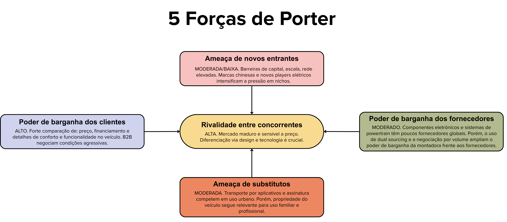 

Fonte: Material produzido pelos autores (2025)
   

Dessa forma, em um mercado altamente disputado e em rápida transformação, a Renault Brasil busca diferenciais ao equilibrar eficiência operacional, inovação orientada ao cliente e uma estratégia comercial omnichannel. A combinação de parque industrial local competitivo, portfólio alinhado ao desejo por SUVs, somada ao avanço em eletrificação acessível para a realidade brasileira, posiciona a marca para defender margens e ganhar participação no mercado. O sucesso dependerá de entregar valor superior (eficiência, segurança, conectividade e experiência) em proporção ao custo total do produto.

### 3.1.2. Análise SWOT (sprint 1)	
 

&nbsp;&nbsp;&nbsp;&nbsp; Segundo Kevin Dunne, a análise SWOT (Strengths, Weaknesses, Opportunities e Threats) é uma ferramenta estratégica utilizada para avaliar a situação atual de uma organização, identificando seus pontos fortes e fracos, assim como as oportunidades e ameaças do ambiente externo. Essa análise possibilita a construção de estratégias mais eficazes, alinhadas aos objetivos da instituição, e contribui para aumentar as chances de sucesso dos projetos.

&nbsp;&nbsp;&nbsp;&nbsp;A aplicação da análise SWOT permite compreender de forma ampla o cenário em que a organização está inserida, nesse caso a Renault Brasil, fornecendo embasamento para decisões mais assertivas. Ao explorar as forças, corrigir as fraquezas, aproveitar as oportunidades e se preparar para as ameaças, é possível garantir um direcionamento mais consistente no andamento do projeto.

### 3.1.2.1  Visualização da análise SWOT:

Figura 2 - Análise SWOT
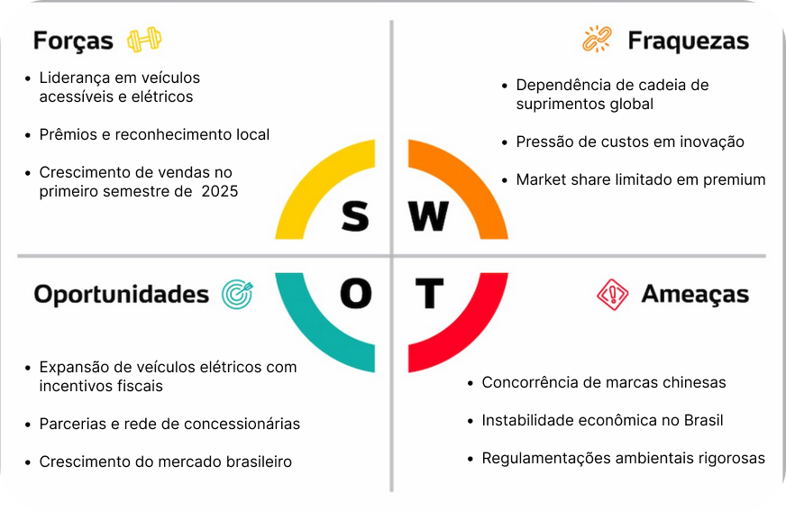
 Fonte: Material alterado pelos autores com base no tamplete disponível em: https://uolhost.uol.com.br/blog/matriz-swot-conheca-melhor-seu-negocio-e-otimize-suas-estrategias/

 

### 3.1.2.2 Forças (Internas):

### Liderança em veículos acessíveis e elétricos
&nbsp;&nbsp;&nbsp;&nbsp; A Renault Brasil destaca-se com o Kwid como o carro mais barato do país e o Kwid E-Tech como veículo elétrico acessível, com IPI zerado, impulsionando vendas em segmentos econômicos e sustentáveis. Isso mitiga fraquezas de custos ao atrair volume de vendas e explora oportunidades de incentivos fiscais, reduzindo impactos de ameaças econômicas.

### Prêmios e reconhecimento local
&nbsp;&nbsp;&nbsp;&nbsp; Modelos como Kardian (Carro do Ano 2025) e Megane E-Tech (Compra do Ano) reforçam qualidade e inovação, com tecnologia OpenR Link integrada. Relaciona-se com fraquezas ao melhorar reputação apesar de recalls, e conecta a oportunidades de mercado, combatendo ameaças de concorrentes.

### Crescimento de vendas no primeiro semestre de 2025
&nbsp;&nbsp;&nbsp;&nbsp; Vendas subiram 8,8% para 60,7 mil unidades no primeiro semestre, tornando o Brasil o 7º mercado global do grupo. Essa força explora oportunidades de expansão veículos elétricos, compensa fraquezas operacionais e resiste a ameaças instáveis via diversificação local.

### 3.1.2.3 Fraquezas (Internas):

### Dependência de cadeia de suprimentos global
&nbsp;&nbsp;&nbsp;&nbsp; Vulnerável a variações cambiais e interrupções, afetando produção local de veículos elétricos e aumentando custos. Agrava ameaças econômicas, enfraquece forças de crescimento, mas oportunidades de incentivos fiscais podem ajudar a reduzir impactos.

### Pressão de custos em inovação
&nbsp;&nbsp;&nbsp;&nbsp; Altos investimentos em tech como E-Tech e OpenR Link pressionam margens, especialmente em um mercado sensível a preços. Limita forças de prêmios, é piorada por ameaças regulatórias, mas interliga a oportunidades de expansão para diluir custos via volume.

### Market share limitado em premium
&nbsp;&nbsp;&nbsp;&nbsp; Foco em econômicos como Kwid restringe penetração em SUVs premium, com recalls recentes afetando confiança. Enfraquece forças de vendas, amplifica ameaças de concorrentes chineses, mas oportunidades de veículos elétricos podem expandir para novos segmentos.

### 3.1.2.4 Oportunidades (Externas):

### Expansão híbridos/EVs no Brasil
&nbsp;&nbsp;&nbsp;&nbsp; Mercado de EVs no Brasil cresce 58% em julho 2025. Parceria com Geely lança EX5 elétrico em julho, usando rede Renault. Kwid E-Tech impulsiona vendas 8,8% no H1.

### Alianças Nissan-Mitsubishi para tech
&nbsp;&nbsp;&nbsp;&nbsp; Aliança Renault-Nissan-Mitsubishi avança em EVs. Compartilham plataformas como CMF-B para Micra EV e Eclipse Cross. Em setembro 2025, projetos conjuntos na fábrica Ampere Douai melhoram EVs e autonomia.

### Aumento concessionárias regionais (Brasil)
&nbsp;&nbsp;&nbsp;&nbsp; No Brasil, 23 novas lojas Geely via Renault em 19 cidades, totalizando 105. Aumenta vendas de EVs. Mercado brasileiro tem 1,8mi unidades até agosto 2025, com Renault crescendo.

### 3.1.2.5 Ameaças (Externas):

### Concorrência de marcas chinesas
&nbsp;&nbsp;&nbsp;&nbsp; Marcas como BYD dominam veículos elétricos com preços agressivos, pressionando market share da Renault Brasil. Enfraquece forças de liderança, piora fraquezas de dependência e reduz oportunidades de expansão.

### Instabilidade econômica no Brasil
&nbsp;&nbsp;&nbsp;&nbsp; Flutuações e pressões comerciais afetam demanda e custos operacionais locais. Desafia forças de vendas, amplifica fraquezas de inovação e ameaça oportunidades de incentivos se políticas mudarem.

### Regulamentações ambientais rigorosas
&nbsp;&nbsp;&nbsp;&nbsp; Normas mais rígidas para emissões exigem adaptações caras em veículos elétricos e produção local. Limita forças de sustentabilidade, agrava fraquezas de custos e impacta oportunidades de mercado se não cumpridas.

### 3.1.2.6 Conclusão: 

&nbsp;&nbsp;&nbsp;&nbsp; A Renault Brasil apresenta um posicionamento sólido no mercado automotivo local, impulsionado por forças internas como a liderança em veículos acessíveis e elétricos, prêmios de reconhecimento e crescimento de vendas de 8,8% no primeiro semestre de 2025. No entanto, fraquezas como a dependência de suprimentos globais, pressão de custos em inovação e market share limitado em segmentos premium demandam atenção para evitar vulnerabilidades.
Em resumo, a Renault Brasil está bem posicionada para crescer na transição para mobilidade elétrica, desde que invista em autonomia operacional e inovação estratégica para equilibrar riscos e capitalizar tendências sustentáveis, visando liderança duradoura no setor.

### 3.1.3. Descrição da Solução a ser Desenvolvida (sprint 1)	

&nbsp;&nbsp;&nbsp;&nbsp;Nesta seção, apresenta-se o desenvolvimento de uma solução IoT voltada ao contexto de Squeak & Rattle (S&R) da Renault do Brasil, alinhando as metas do projeto às demandas de engenharia e qualidade. A solução busca padronizar a aquisição de sinais dinâmicos em pista (A×t e F×t), transmiti-los com confiabilidade para uma plataforma em nuvem, armazená-los de forma rastreável e oferecer visualização analítica inicial. 

&nbsp;&nbsp;&nbsp;&nbsp;Essa base sustentará análises e-line reprodutíveis e, no médio prazo, viabilizará a construção de um sinal de entrada genérico para S&R, beneficiando a tomada de decisão e a eficiência operacional.

#### 3.1.3.1 Qual é o problema a ser resolvido

&nbsp;&nbsp;&nbsp;&nbsp;O processo de avaliação e-line para S&R exige sinais dinâmicos representativos dos diferentes perfis de pista que excitam o veículo. Hoje, a ausência de uma base padronizada, rastreável e reprodutível desses sinais dificulta a análise objetiva, aumenta retrabalho e retarda decisões de engenharia.

#### 3.1.3.2 Qual a solução proposta (visão de negócios)

&nbsp;&nbsp;&nbsp;&nbsp;A solução proposta é um protótipo IoT compacto que adquire sinais de aceleração (A×t) e força (F×t) em condições reais de rodagem, transmite os dados via MQTT, e persiste os arquivos e metadados em um repositório organizado.

Em termos de valor de negócios, a solução:

- Padroniza o insumo das análises e-line, reduzindo variação operacional.
- Aumenta a confiabilidade e governança do ciclo de vida dos dados de teste.
- Acelera a tomada de decisão (dados prontos para consumo analítico).
- Cria a base para um sinal de entrada genérico de S&R e para evoluções analíticas (indicadores, espectros, automações).

#### 3.1.3.3 Como a solução proposta deverá ser utilizada

**Instrumentação** - O módulo embarcado (acelerômetros + sensor de força + condicionamento + MCU/SoC) é acoplado ao equipamento/veículo conforme plano de ensaio.

**Rodagem em pista** - Executam-se campanhas nos perfis de pista definidos, seguindo procedimento (velocidade-alvo/intervalo, duração, repetições).

**Transmissão** - Durante a rodagem, os pacotes são publicados via MQTT; se houver perda de conexão, entra o buffer local e a publicação é retomada ao reconectar.

**Armazenamento e visualização** - Os dados brutos e metadados (pista, equipamento/veículo, timestamps) são persistidos e disponibilizados em dashboard/visualizador para inspeção, pré-processamento (ex.: filtragem) e análises iniciais.

**Rastreabilidade** - Cada sessão recebe identificadores únicos e um checklist automático de metadados, permitindo auditoria técnica e comparabilidade entre campanhas.

#### 3.1.3.4 Quais os benefícios trazidos pela solução proposta

- Aquisição padronizada de sinais dinâmicos A×t e F×t em condições reais de rodagem.
- Precisão e padronização nas análises e-line, com sinais comparáveis entre pistas e ao longo do tempo.
- Governança e rastreabilidade ponta-a-ponta (coleta -> transmissão -> persistência -> análise).
- Eficiência operacional, com menos retrabalho e menor tempo para preparar/validar ensaios.
- Base para escala analítica, viabilizando espectros padronizados e indicadores de criticidade.
- Evolutividade: insumo concreto para compor um sinal de entrada genérico para S&R e automações futuras.

#### 3.1.3.5 Qual será o critério de sucesso e qual medida será utilizada para o avaliar

&nbsp;&nbsp;&nbsp;&nbsp;O critério de sucesso da solução proposta é a sua capacidade de atender às demandas de engenharia e qualidade da Renault do Brasil para Squeak & Rattle: comprovar, em rodagem controlada, a viabilidade técnica do protótipo para adquirir, transmitir, armazenar e visualizar sinais A×t e F×t com rastreabilidade completa e utilidade analítica inicial.

Tal critério será avaliado com base nos seguintes indicadores-chave de desempenho (KPIs):
- Precisão dos dados adquiridos: Verificar se os sinais A×t e F×t atendem às especificações técnicas estabelecidas (ex.: resolução, taxa de amostragem).
- Taxa de transmissão bem-sucedida: Medir a porcentagem de pacotes MQTT transmitidos com sucesso para a plataforma em nuvem durante as campanhas.
- Rastreabilidade dos dados: Avaliar a completude dos metadados associados a cada sessão de teste, garantindo que todas as informações relevantes estejam registradas.
- Satisfação do usuário final: Coletar feedback dos engenheiros de S&R sobre a usabilidade e utilidade da solução na prática.

### 3.1.4. Value Proposition Canvas (sprint 1)	

&emsp; O Canvas de Proposta de Valor é uma ferramenta desenvolvida para ajudar empresas a compreender como um projeto pode atender de forma efetiva às necessidades e expectativas de seus clientes. Criado por Alexander Osterwalder, o modelo permite estruturar os elementos que realmente geram valor para o público-alvo, destacando os ganhos proporcionados por um produto ou serviço e as dores que ele se propõe a resolver. Essa abordagem contribui para uma visão mais estratégica e centrada no cliente, garantindo que as soluções desenvolvidas estejam alinhadas ao que realmente importa para o consumidor (Osterwalder et al., 2014).

&emsp; No contexto da Renault Brasil, a busca por inovação constante no processo de desenvolvimento automotivo trouxe à tona um desafio importante: aprimorar as simulações de Squeak and Rattle (S&R) — ruídos e pressões indesejadas que afetam o conforto e a percepção de qualidade dos veículos. Para enfrentar esse problema, a empresa aposta em uma solução baseada em Internet das Coisas (IoT), capaz de capturar dados de velocidade e aceleração em tempo real.

&emsp; Com isso, torna-se possível realizar análises mais precisas e preditivas ainda nas fases iniciais de desenvolvimento, identificando potenciais falhas estruturais antes mesmo da construção dos protótipos físicos. O resultado é um processo mais ágil, econômico e assertivo, que reduz custos, retrabalhos e tempo de projeto, ao mesmo tempo em que eleva o padrão de qualidade e o conforto percebido pelo cliente final.

#### 3.1.4.1 Proposta de Valor

&emsp; A proposta de valor da Renault Brasil representa o conjunto de benefícios e soluções tecnológicas oferecidas às suas equipes de engenharia e P&D, com o objetivo de resolver desafios práticos e estratégicos no desenvolvimento veicular.

#### 3.1.4.2 Criadores de Ganho

- Identificação antecipada de falhas de Squeak and Rattle antes da prototipagem.

- Redução expressiva de custos com retrabalho e fabricação de protótipos físicos.

- Aceleração do ciclo de desenvolvimento e validação de novos modelos.

- Aumento da precisão e da confiabilidade das simulações virtuais.

- Melhoria perceptível no conforto acústico e na qualidade percebida.

- Fortalecimento da imagem da Renault como referência em inovação e engenharia digital.

#### 3.1.4.3 Produtos e Serviços

- Sistema IoT para captura e transmissão de dados de velocidade, aceleração e pressão.

- Plataforma integrada de análise de dados conectada aos softwares de simulação da Renault.

- Dashboard interativo para acompanhamento e visualização em tempo real.

- Relatórios automáticos com insights sobre falhas potenciais e pontos críticos.

- Algoritmos de machine learning para detecção de padrões e anomalias em testes virtuais.

#### 3.1.4.4 Alívio das Dores

- Diminuição da dependência de protótipos físicos e testes manuais demorados.

- Redução dos custos com repetição de testes e retrabalhos.

- Eliminação de incertezas nas etapas iniciais de projeto.

- Comunicação mais eficiente entre design, engenharia e validação.

- Melhor aproveitamento de tempo e recursos no processo de desenvolvimento.

#### 3.1.4.5 Ganhos

- Maior eficiência e agilidade no ciclo de desenvolvimento de veículos.

- Economia de recursos financeiros, humanos e de infraestrutura.

- Modernização do processo de simulação de Squeak and Rattle.

- Resultados técnicos mais confiáveis e previsíveis.

- Elevação do padrão de qualidade, conforto e percepção de valor dos veículos.

#### 3.1.4.7 Dores

- Custos elevados com prototipagem e testes físicos.

- Dificuldade em detectar falhas estruturais nas fases iniciais.

- Retrabalho devido à identificação tardia de problemas.

- Limitações das simulações atuais por falta de dados reais de dinâmica veicular.

- Pressão por prazos curtos em ciclos de desenvolvimento cada vez mais exigentes.

#### 3.1.4.8 Tarefas do Cliente

- Desenvolver veículos que ofereçam conforto acústico e robustez estrutural.

- Validar o desempenho de ruído e pressão antes da construção de protótipos.

- Antecipar falhas de Squeak and Rattle com base em dados reais e simulações inteligentes.

- Integrar as fases de design, simulação e testes de forma fluida e colaborativa.

- Cumprir metas de inovação, eficiência e sustentabilidade dentro do processo de P&D.

#### 3.1.4.9 Conclusão

&emsp; A solução proposta para a Renault Brasil redefine o modo como a engenharia automotiva lida com ruídos e pressões, ao integrar tecnologias de IoT e IA no processo de simulação. A coleta de dados reais de aceleração e velocidade permite uma análise preditiva mais confiável e acessível, reduzindo a dependência de protótipos físicos e aumentando a eficiência das equipes.

&emsp; Com dashboards intuitivos, relatórios automáticos e algoritmos inteligentes, os engenheiros passam a contar com informações em tempo real para tomar decisões mais assertivas. O resultado é um processo de desenvolvimento mais ágil, sustentável e orientado por dados, que reforça a posição da Renault como uma marca inovadora e comprometida com a excelência técnica.

&emsp; Essa abordagem inaugura um novo paradigma na engenharia automotiva: unir tecnologia e engenharia para criar veículos mais silenciosos, confortáveis e sofisticados — refletindo não apenas eficiência técnica, mas também o cuidado com a experiência do motorista e o legado da marca Renault.

Figura 3- Canvas Proposta de Valor 

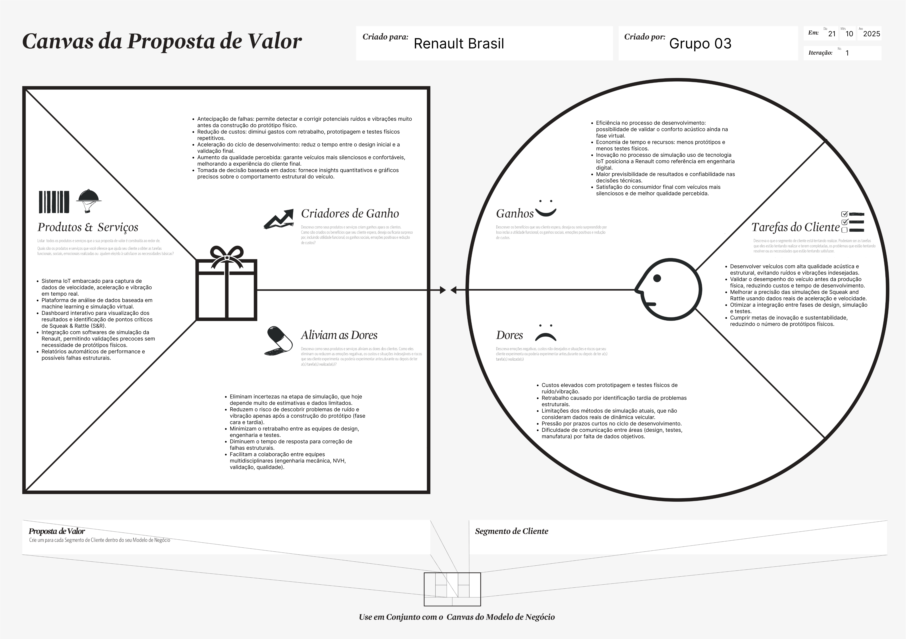

Fonte: Material produzido pelos autores (2024)

### 3.1.5. Matriz de Riscos (sprint 1)	

&emsp; Segundo Tomaz, Gagliasso e Malavota (2020), a matriz de riscos é uma ferramenta analítica que permite visualizar e gerenciar as incertezas de um projeto por meio da relação entre a probabilidade de ocorrência e o impacto potencial de cada risco. Ao estruturar essas variáveis em um formato matricial, ela fornece uma base racional para priorização e tomada de decisão, promovendo ações preventivas e corretivas mais eficazes. Além disso, por ser parte de um processo iterativo, a matriz evolui com o projeto, incorporando novos riscos e reavaliando os existentes, o que a torna um instrumento dinâmico e indispensável à gestão estratégica.

&emsp; No contexto da Renault, a matriz de riscos permite identificar ameaças e falhas que possam comprometer as operações de telemetria e análise de dados veiculares em pista, além de, por meio de seu eixo de oportunidades, explorar caminhos voltados à inovação e à segurança dos dados na infraestrutura IoT em desenvolvimento pelo grupo. Diante da crescente demanda por otimização dos processos de engenharia automotiva e das rápidas transformações tecnológicas no setor de IoT, essa ferramenta assegura resiliência e agilidade, fortalecendo a capacidade da Renault em desenvolver veículos mais eficientes e seguros, especialmente na identificação e mitigação de problemas de squeak and rattle.

Figura 4 - Matriz de Riscos e Oportunidades 
   
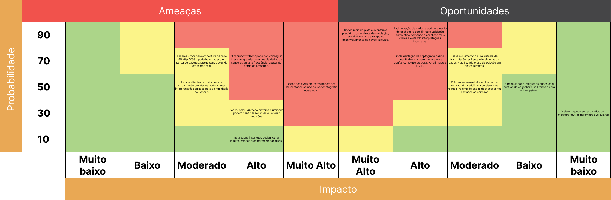 

Fonte: Material produzido pelos autores (2024)
   

&emsp; A matriz de risco identificou algumas ameaças importantes para o projeto de telemetria veicular. Entre elas, destaca-se a sobrecarga de processamento do microcontrolador, que pode não conseguir lidar com grandes volumes de dados de sensores de velocidade e aceleração em alta frequência, causando perda de amostras críticas e comprometendo a precisão das simulações. Outro fator crítico é a vulnerabilidade de segurança dos dados, onde informações sensíveis de testes podem ser interceptados se não houver criptografia adequada, expondo dados estratégicos sobre o desenvolvimento de novos veículos. Adicionalmente, a instabilidade de conectividade em áreas com baixa cobertura de rede pode causar atraso ou perda de pacotes durante a transmissão dos dados para o banco de dados remoto, prejudicando a continuidade do monitoramento em tempo real. As condições adversas do ambiente de pista, como poeira, calor extremo, pressão e umidade, também representam ameaças ao funcionamento adequado dos sensores, podendo alterar medições e gerar dados inconsistentes que comprometem as análises de squeak and rattle.

&emsp; Por outro lado, a matriz de risco também ressalta oportunidades estratégicas que impulsionam a inovação e ampliam o valor do projeto. O aproveitamento de dados reais de pista aumenta significativamente a precisão dos modelos de simulação de squeak and rattle, reduzindo custos e tempo no desenvolvimento de novos veículos ao permitir testes virtuais mais confiáveis antes da produção. Outra oportunidade crucial é a padronização de dados e aprimoramento do dashboard com filtros e validação automática, tornando as análises mais claras e evitando interpretações incorretas que poderiam levar a decisões equivocadas de engenharia. O desenvolvimento de um sistema de transmissão resiliente e inteligente de dados também se destaca, viabilizando o uso da solução em pistas remotas e expandindo as possibilidades de testes em diferentes condições. A implementação de criptografia e segurança alinhada à LGPD representa uma oportunidade de garantir confiança no uso corporativo e proteção da propriedade intelectual. Por fim, o pré-processamento local dos dados otimiza a eficiência do sistema, reduzindo o volume de informações desnecessárias enviadas ao servidor e melhorando o desempenho geral da solução.

&emsp; Conforme o contexto supramencionado, essas ameaças e oportunidades demonstram a importância de uma matriz de risco completa e bem estruturada para a Renault, permitindo tanto a mitigação de problemas técnicos quanto o aproveitamento do potencial de impacto positivo no desenvolvimento automotivo, especialmente na redução de problemas de squeak and rattle através de simulações mais precisas baseadas em dados reais de pista.

### 3.1.6. Política de Privacidade de acordo com a LGPD (sprint 1)	

&nbsp;&nbsp;&nbsp;&nbsp;*Esta política de privacidade é válida a partir de outubro de 2025.*

&nbsp;&nbsp;&nbsp;&nbsp;Esta Política de Privacidade é redigida em conformidade com a Lei nº 13.709/2018, Lei Geral de Proteção de Dados Pessoais, e com as normas correlatas de proteção da privacidade no Brasil. O documento materializa o compromisso da nossa organização estudantil, atuando como empresa no contexto do projeto para a Renault Brasil, com os princípios de finalidade, adequação, necessidade, livre acesso, qualidade dos dados, transparência, segurança, prevenção, não discriminação e responsabilização. Desde a concepção e por padrão, adotamos uma abordagem de proteção de dados por desenho e por defeito, de modo que controles técnicos e organizacionais sejam incorporados ao ciclo de desenvolvimento da solução IoT e dos serviços associados.

&nbsp;&nbsp;&nbsp;&nbsp;A presente seção existe para definir com clareza como os dados pessoais serão tratados no escopo do projeto, quais atores assumem responsabilidades pelo tratamento, quais direitos assistem aos titulares e de que forma são atendidos. A descrição transparente do tratamento reduz riscos regulatórios e contratuais, orienta processos internos, fortalece a confiança de usuários e parceiros, e cria um registro formal de governança e prestação de contas perante a Autoridade Nacional de Proteção de Dados e demais partes interessadas.

#### 3.1.6.1 Informações gerais sobre a empresa / organização

&nbsp;&nbsp;&nbsp;&nbsp;A controladora do tratamento de dados pessoais, para fins desta iniciativa acadêmica com simulação empresarial, é a organização do projeto identificada como Rythmo, estabelecida em Rua Professor Almeida Prado, 520, inscrita no XXX.XXX.XXX/XXXX-XX, que define finalidades e toma as decisões essenciais sobre as operações de tratamento no âmbito da solução de monitoramento e análise para Squeak and Rattle. Em determinados fluxos específicos, fornecedores de tecnologia e serviços atuarão como operadores, sempre mediante contratos com cláusulas de proteção de dados compatíveis com a legislação aplicável.

#### 3.1.6.2 Informações sobre o tratamento de dados

&nbsp;&nbsp;&nbsp;&nbsp;O tratamento compreende a coleta, a produção, a recepção, a classificação, a utilização, o acesso, a reprodução, a transmissão, a distribuição, o processamento, o arquivamento, o armazenamento, a eliminação, a avaliação e o controle da informação, a modificação, a comunicação, a transferência, a difusão e a extração de dados pessoais relacionados ao uso dos sistemas da solução, à gestão de contas de usuários internos, à interação com interfaces de suporte e à eventual integração com ambientes corporativos da contratante. Cada operação observará base legal adequada, registro de atividades e minimização do volume de dados estritamente necessário à finalidade.

#### 3.1.6.3 Quais são os dados coletados

&nbsp;&nbsp;&nbsp;&nbsp;Os dados coletados podem incluir informações de identificação e contato do usuário interno da solução, como nome, e mail corporativo e credenciais de acesso, registros de uso e telemetria da aplicação, como horários de acesso, endereço IP e eventos de navegação, e dados técnicos decorrentes do projeto IoT quando houver associação a pessoa natural identificada ou identificável, como marcações de sessão e georreferenciamento ativado por decisão do usuário ou do time de testes. Não é objetivo do projeto coletar dados sensíveis e, caso em cenário excepcional tal coleta se faça indispensável, serão aplicadas salvaguardas reforçadas e base legal apropriada.

#### 3.1.6.4 Onde os dados são coletados 

&nbsp;&nbsp;&nbsp;&nbsp;A coleta ocorre nas interfaces de cadastro e autenticação da plataforma, nos módulos de captura e publicação de dados do dispositivo IoT quando a sessão puder ser relacionada a um usuário, nos painéis de visualização e análise utilizados por equipes de engenharia e nas rotinas administrativas de suporte e melhoria contínua do serviço. A coleta pode ocorrer também por meio de comunicações operacionais enviadas pelo time do projeto aos usuários, desde que pertinentes à execução dos serviços.

#### 3.1.6.5 Para quais finalidades os dados serão utilizadas

&nbsp;&nbsp;&nbsp;&nbsp;Os dados são utilizados para permitir o funcionamento da solução, administrar o ciclo de vida das contas, autenticar e autorizar acessos, registrar a execução de testes e sessões, viabilizar a transmissão e a integridade dos pacotes publicados, apresentar informações em painéis de análise, prestar suporte técnico, conduzir auditorias e melhorar continuamente a performance, a segurança e a usabilidade. Em hipóteses específicas, dados podem ser usados para cumprir obrigações legais ou regulatórias e para atender solicitações formais de autoridades competentes, quando juridicamente exigido.

#### 3.1.6.6 Onde os dados ficam armazenados 

&nbsp;&nbsp;&nbsp;&nbsp;Os dados são armazenados em infraestrutura de computação em nuvem contratada pela organização do projeto, com ambientes segregados por finalidade e controles de acesso baseados em papéis. Sempre que tecnicamente viável, aplica se criptografia em repouso e em trânsito, chaves geridas com políticas de rotação e registros de acesso com trilhas de auditoria. Eventuais redundâncias geográficas seguem a política de continuidade de negócios e os requisitos contratuais pactuados com a contratante.

#### 3.1.6.7 Qual o período de armazenamento dos dados (retenção)

&nbsp;&nbsp;&nbsp;&nbsp;Os dados são conservados pelo tempo necessário para cumprir as finalidades informadas e por prazos adicionais necessários para atendimento de obrigações legais, exercício regular de direitos em processos, auditorias e defesa de interesses. Ao término das finalidades ou transcorridos os prazos legais, aplica se procedimento de exclusão segura ou anonimização, preservando se somente informações residuais que, por imposição normativa ou exigência de responsabilidade, precisem permanecer arquivadas.

#### 3.1.6.8 Uso de cookies e/ou tecnologias semelhantes

&nbsp;&nbsp;&nbsp;&nbsp;A solução pode utilizar cookies e tecnologias equivalentes para autenticação, manutenção de sessão, segurança, medição de desempenho e análise de uso. O usuário poderá gerir preferências por meio das configurações do navegador e dos controles disponibilizados na própria aplicação, ciente de que a desativação de componentes estritamente necessários pode comprometer funcionalidades essenciais.

#### 3.1.6.9 Com quem esses dados são compartilhados (parceiros, fornecedores, subcontratados)

&nbsp;&nbsp;&nbsp;&nbsp;O compartilhamento de dados pessoais limita se a terceiros estritamente necessários à execução dos serviços, como provedores de nuvem, componentes de mensageria, ferramentas de observabilidade e suporte técnico, sempre sob contratos que imponham confidencialidade, uso limitado à finalidade contratada e padrões de segurança compatíveis. Caso ocorra transferência internacional, serão adotados mecanismos previstos na legislação para garantir nível adequado de proteção, como cláusulas contratuais específicas e avaliações de impacto.

#### 3.1.6.10 Informações sobre medidas de segurança adotadas pela empresa

&nbsp;&nbsp;&nbsp;&nbsp;A organização adota um conjunto de medidas técnicas e administrativas proporcional aos riscos identificados, incluindo gestão de identidades e acessos com princípios de menor privilégio, segregação de ambientes, criptografia, monitoramento de atividades relevantes, processo de gestão de vulnerabilidades, testes periódicos de segurança, políticas de continuidade e plano de resposta a incidentes. Em caso de incidentes que possam acarretar risco ou dano relevante aos titulares, a organização promoverá a devida comunicação aos afetados e à autoridade competente, conforme exigido em lei.

#### 3.1.6.11 Orientações sobre como a empresa/organização atende aos direitos dos usuários

&nbsp;&nbsp;&nbsp;&nbsp;Os direitos de confirmação da existência de tratamento, acesso, correção, anonimização, bloqueio ou eliminação, portabilidade, informação sobre compartilhamentos e sobre a possibilidade de não fornecer consentimento, bem como a revisão de decisões automatizadas quando aplicável, podem ser exercidos mediante solicitação direcionada aos canais oficiais desta Política. As demandas serão analisadas sob critérios de autenticidade do solicitante, viabilidade técnica e fundamentos legais, com resposta em prazos compatíveis com a LGPD e com a complexidade do pedido.

#### 3.1.6.12 Informações sobre como o titular de dados pode solicitar e exercer os seus direitos

&nbsp;&nbsp;&nbsp;&nbsp;O titular poderá encaminhar solicitação clara e específica por meio do correio eletrônico indicado na presente Política ou por endereço físico disponibilizado, informando os dados necessários à verificação de identidade e à localização do registro. Quando a solicitação envolver dados processados em nome de terceiros contratantes, a organização atuará de modo coordenado com o respectivo controlador, comunicando o andamento e o resultado ao titular.

#### 3.1.6.13 Informações de contato do Data Protection Officer (DPO) ou encarregado de proteção de dados da organização

&nbsp;&nbsp;&nbsp;&nbsp;O encarregado pelo tratamento de dados pessoais desta organização é Claudio Fernando André, que pode ser contatado pelo e mail claudio.andre@prof.inteli.edu.br e pelo endereço Rua Professor Almeida Prado, 520. O encarregado atua como canal de comunicação entre titulares, a organização e a Autoridade Nacional de Proteção de Dados e está à disposição para esclarecimentos, solicitações e sugestões relacionados a esta Política.

### 3.1.7. Bill of Material (BOM)
# Bill of Materials (BOM)

&nbsp;&nbsp;&nbsp;&nbsp;A seguir, apresentamos a Bill of Material (BOM), que consiste na lista completa de materiais e componentes necessários para a construção, manutenção e possíveis reparos do dispositivo IoT descrito neste documento.

Abaixo estão as informações do projeto para a Bill of Materials:

Tabela 1 - Sobre a Bill of Materials 

| Título do Projeto           | Rythmo IoT |
| --------------------------- | ----------- |
| Autor                       | Rythmo    |
| Número do documento         | S/N         |
| Revisão                     | 0           |
| Total de componentes da PCI | 8         |

Fonte: Material produzido pelos autores (2025)

Abaixo está a Bill of Materials dos materiais que serão utilizados no projeto:

Tabela 2 - Bill of Materials 

| Item | Categoria        | Código do Produto   | Descrição               | Quantidade | Preço Unitário | Total    | Observações                  |
|------|------------------|---------------------|-------------------------|------------|----------------|----------|------------------------------|
| 1    | Microcontrolador | ESP32-DEVKITC       | Microcontrolador ESP 32 | 1          | R$ 50,00       | R$ 50,00 | Verificar USB (CP2102/CH340) |
| 2    | Sensor           | 7BB-27-4L0          | Disco Piezoelétrico     | 1          | R$ 15,00       | R$ 15,00 | 3.3V ou 5V                   |
| 3    | Sensor           | GY-521 (MPU6050)    | Módulo Acelerômetro     | 1          | R$ 15,00       | R$ 15,00 | 3.3V ou 5V                   |
| 4    | Botão            | B3F-1020            | Push Button             | 4          | R$ 1,00        | R$ 4,00  | Máx 12V                      |
| 5    | Display          | 1602A               | Monitor LCD             | 1          | R$ 30,00       | R$ 30,00 | 5V; 16:2; chip I2C           |
| Total |||||| R$ 114,00 |

Fonte: Material produzido pelos autores (2025)

## 3.2. Domínio de Fundamentos de Experiência de Usuário 

### 3.2.1. Personas (sprint 1)	

&nbsp;&nbsp;&nbsp;&nbsp;Segundo Louise Bruton (2022), personas no contexto de UI/UX, são representações fictícias de usuários reais, criadas com base em pesquisas qualitativas e quantitativas para auxiliar designers a compreenderem melhor o público-alvo e tomarem decisões de design mais informadas. Essas personas incluem detalhes demográficos, comportamentais, motivações, dores e objetivos, promovendo empatia e garantindo que o produto priorize as necessidades dos usuários, o que resulta em experiências mais intuitivas e eficazes.

&nbsp;&nbsp;&nbsp;&nbsp;Tendo em vista esses pontos, em nosso projeto nós criamos duas personas: um sendo o piloto que conduzirá o carro em tetes de Squeak and Rattle e o outro sendo o engenheiro de simulação da Renault, que analisará o resultados e relatórios para tirar conclusões úteis. Fizemos isso para auxiliar o desenvolvimento do projeto e não perdermos de vista os nossos objetivos.

**João Silva, Piloto de Teste**

&nbsp;&nbsp;&nbsp;&nbsp;João Silva representa o usuário operacional que interage diretamente com o dispositivo IoT durante os testes em pistas. Como piloto experiente, ele será responsável por instalar o dispositivo, ativar o sistema embarcado e conduzir o veículo em condições reais de rodagem, coletando dados de aceleração (A x t) e força (F x t).

**Por que a persona João Silva?**

&nbsp;&nbsp;&nbsp;&nbsp;Entender as dores de João, como configurações complexas que demandam tempo ou interferem na condução, permite projetar interfaces simples e intuitivas. Isso reduz riscos, como distrações durante a direção, alinhando-se ao objetivo de coletar dados de forma automatizada e confiável.

&nbsp;&nbsp;&nbsp;&nbsp;Personas como essa promovem empatia para experiências diferentes das dos desenvolvedores, ajudando a priorizar requisitos como conectividade Wi-Fi/Bluetooth robusta e feedback imediato sobre a qualidade das medições. No MVP do projeto, isso assegura que o hardware seja prático, evitando falhas que invalidem rodagens inteiras e contribuindo para a viabilidade técnica da solução IoT.

 

**Maria Oliveira, Engenheira de Simulação**

&nbsp;&nbsp;&nbsp;&nbsp;Maria Oliveira personifica o usuário analítico que processa os dados coletados, utilizando-os para simulações CAE (Computer-Aided Engineering) de Squeak and Rattle. Como engenheira sênior, ela acessa a plataforma as a service, analisa sinais para gerar indicadores de criticidade e espectros de frequência, e integra os dados em modelos virtuais.

**Por que a persona Maria Oliveira?**

&nbsp;&nbsp;&nbsp;&nbsp;As frustrações de Maria, como a falta de dados confiáveis e coletivamente exaustivos de diferentes cenários de rodagem reais e de diferentes veículos, necessários para alavancar a qualidade de análises Squeak and Rattle, destacam a necessidade de padronização e armazenamento contínuo. Isso apoia o objetivo do projeto de criar um sinal de entrada genérico para avaliações "e-line", permitindo análises comparativas e previsões precisas.

&nbsp;&nbsp;&nbsp;&nbsp;Ao entender motivações como avançar na precisão das simulações para veículos mais duráveis, a persona alinha o design com necessidades de integração com softwares existentes, como brokers MQTT.

**Conclusão**

&nbsp;&nbsp;&nbsp;&nbsp;As personas João Silva e Maria Oliveira são fundamentais para um design centrado no usuário, construindo empatia e prevendo interações em um projeto IoT complexo. Elas garantem que o protótipo atenda às demandas operacionais e analíticas, alinhando-se aos objetivos da Renault de automação, precisão e sustentabilidade. Ao incorporar essas representações, o projeto não só resolve problemas práticos, como aquisição de dados em pistas variadas, mas também pavimenta o caminho para expansões com IA e simulações digitais.

### 3.2.2. Jornada do Usuário e Storyboard (sprint 2)	

#### 3.2.2.2 Fundamentação Teórica de um storyboard

&emsp; De acordo com Marissa Sapega, um storyboard é uma representação gráfica de uma narrativa, conceito ou roteiro, dividida em cenas sequenciais (painéis). Essas ferramentas visuais são tradicionalmente utilizadas para mapear como um script ou história se desenrolará uma vez animado ou encenado, mas pessoas as utilizam para diversas situações. Sapega explica que "storyboarding" é simplesmente o ato de criar um storyboard, e para obter os melhores resultados, é necessário equilibrar o fornecimento de informações visuais suficientes para contar a história de forma compreensível, sem torná-la excessivamente detalhada.

&emsp; No contexto do nosso projeto Rythmo, o storyboard é utilizado para ilustrar como a solução IoT será utilizada no cotidiano da engenheira de simulação Maria Oliveira, servindo como um guia visual prático das suas interações com o sistema. A vantagem de usar imagens sequenciais é que elas tornam a jornada do usuário fácil de entender à primeira vista e facilitam a memorização dos pontos de contato críticos entre a persona e o produto.

#### 3.2.2.3 Estrutura de um storyboard
Em geral, a criação de um storyboard inclui três elementos principais:

- Cenário: Os storyboards são baseados em um cenário ou em uma história de usuário específica, claramente especificado ao longo da narrativa visual.
- Visual: São as representações gráficas ou ilustrações da interação de cada etapa do cenário.
- Legenda: Cada visual tem uma descrição correspondente que explica brevemente as ações do usuário, ambiente, estado emocional e contexto técnico.

#### 3.2.2.4 Aplicação no Projeto
&emsp; Nesse sentido, no projeto Rythmo, o storyboard desempenha um papel fundamental ao permitir a visualização de como a persona Maria Oliveira, engenheira de simulação da Renault, interage com o sistema IoT de coleta de dados de Squeak and Rattle. O storyboard é baseado na jornada dessa persona específica, que enfrenta frustrações com a falta de dados confiáveis para simulações CAE e descobre na solução proposta uma ferramenta transformadora para seu trabalho.

&emsp; A criação de um storyboard detalhado para Maria permite identificar melhor suas necessidades técnicas e expectativas profissionais, ajudando nas tomadas de decisões do projeto em relação à interface do dashboard, funcionalidades de exportação de dados e integração com softwares de simulação existentes. Além disso, refina a usabilidade do produto, tornando o sistema mais intuitivo e alinhado às metas de precisão e eficiência nas análises de engenharia automotiva.

#### 3.2.2.5 Storyboard Maria Oliveira

##### 3.2.2.5.1 Figura do storyboard da Maria

 Figura 5 - Storyboard Maria Oliveira 

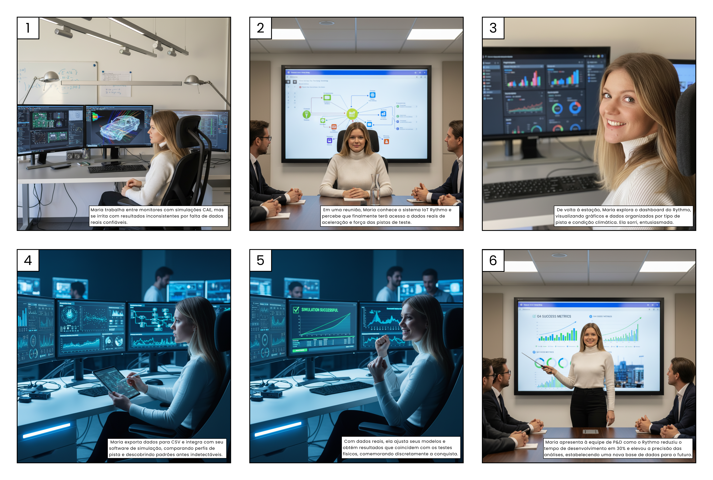

 Fonte: Material produzido pelos autores (2025) 

##### 3.2.2.5.2 Descrição das tarefas no storyboard da Maria

- Quadro 1: Maria está em sua estação de trabalho, cercada por monitores mostrando simulações CAE. Ela se frusta com resultados inconsistentes, devido a falta de dados reais confiáveis.
- Quadro 2: Maria participa de uma reunião onde é apresentado o sistema IoT Rythmo. Seus olhos se iluminam ao compreender que finalmente terá acesso a dados reais de aceleração e força coletados diretamente das pistas de teste.
- Quadro 3: Em sua estação, Maria acessa pela primeira vez o dashboard do sistema Rythmo. A interface intuitiva exibe dados organizados por tipo de pista, velocidade e condições climáticas. Ela sorri ao visualizar gráficos de aceleração em tempo real.
- Quadro 4: Maria exporta dados para CSV e integra com seu software de simulação. Ela compara sinais de diferentes perfis de pista (lisa, esburacada, paralelepípedo), identificando padrões que antes eram impossíveis de detectar.
- Quadro 5: Com os dados reais, Maria ajusta seus modelos de simulação e-line. Os resultados agora convergem perfeitamente com os testes físicos. Ela comemora discretamente o sucesso, erguendo o punho em sinal de vitória.
- Quadro 6: Maria apresenta seus resultados em reunião com a equipe de P&D (Pesquisa e Desenvolvimento). Ela demonstra como o sistema Rythmo reduziu o tempo de desenvolvimento e aumentou a precisão das análises de Squeak and Rattle, estabelecendo uma nova base de dados padronizada para projetos futuros.

#### 3.2.2.6 Storyboard João Silva

##### 3.2.2.6.1 Figura do storyboard do João

 Figura 6 - Storyboard João Silva 

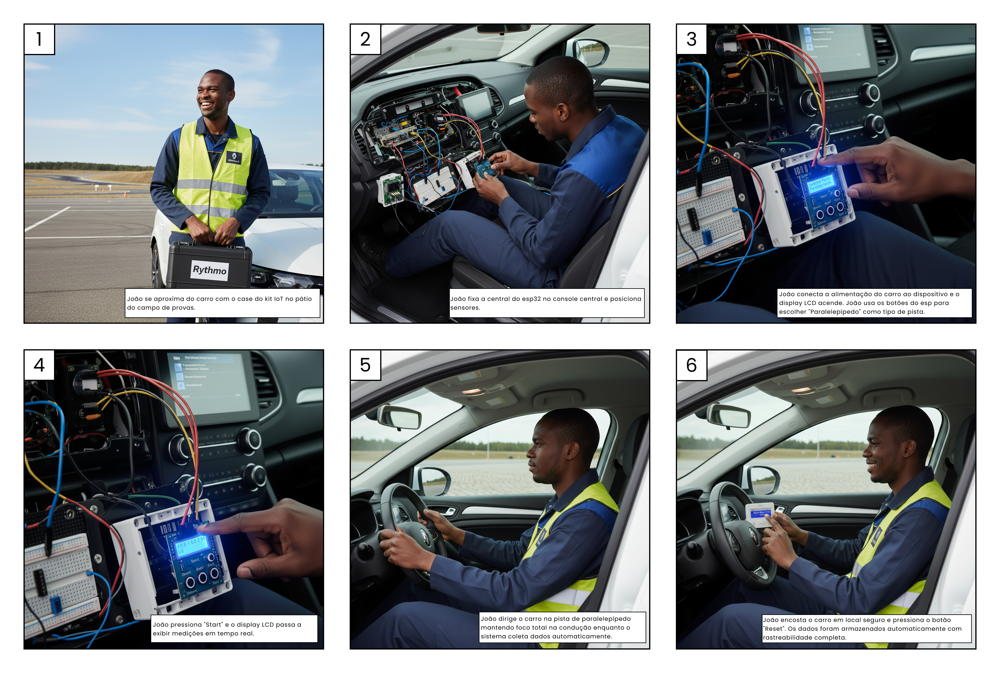

 Fonte: Material produzido pelos autores (2025) 

##### 3.2.2.5.2 Descrição das tarefas no storyboard do João

- Quadro 1: João chega ao pátio do campo de provas com o case do kit IoT Rythmo. Ele se aproxima do veículo de testes e verifica visualmente seu estado antes de iniciar a instalação, demonstrando sua rotina profissional de preparação. O case contém ESP32, sensores e cabos organizados, prontos para instalação rápida.
- Quadro 2: Dentro do veículo, João trabalha metodicamente fixando a central ESP32 no console central. Posiciona o acelerômetro na porta frontal direita para captar vibrações laterais e instala o sensor de força próximo ao painel. Os cabos são organizados com etiquetas coloridas: azul para aceleração e vermelho para força, facilitando identificação futura.
- Quadro 3: João conecta a alimentação do sistema à fonte de energia do veículo. Ao ligar, o display LCD acende mostrando a tela inicial. João ativa o hotspot em seu celular e, usando os botões físicos (Options, Select, Reset), navega até encontrar "Paralelepípedo" na lista de pistas. Após pressionar "Select", o display exibe "Selected Pista: Paralelepípedo", confirmando a configuração.
- Quadro 4: João pressiona o botão "Start" para iniciar a coleta. O display LCD muda para o modo de medição, exibindo em tempo real: primeira linha com "X:0.0 Y:0.0 Z:9.8" (aceleração nos eixos em m/s²) e segunda linha com "V:0" (sensor de força). Esta configuração minimalista permite monitoramento rápido sem distrações durante a condução.
- Quadro 5: João conduz o veículo pela pista de paralelepípedos com concentração profissional, ambas as mãos no volante. A pista gera vibrações características capturadas pelos sensores em tempo real. O display continua mostrando as variações de X, Y, Z e V conforme o veículo passa pelas irregularidades, sem necessidade de interação durante a condução.
- Quadro 6: Ao completar o trajeto, João encosta o veículo em local seguro e pressiona "Reset". O display LCD retorna à tela inicial "Select Pista: Lisa", indicando que o sistema está pronto para nova sessão. Os dados foram automaticamente armazenados com timestamps e associados ao perfil "Paralelepípedo", garantindo rastreabilidade completa para análises futuras.

#### 3.2.2.7 Conclusão

&nbsp;&nbsp;&nbsp;&nbsp; A criação dos storyboards para as personas Maria Oliveira e João Silva foi fundamental para visualizar e compreender as interações críticas entre os usuários e o sistema IoT Rythmo. Ao mapear suas jornadas, conseguimos identificar pontos de contato essenciais, necessidades específicas e expectativas que guiaram o desenvolvimento do projeto. Esses storyboards não apenas facilitaram a comunicação entre a equipe de desenvolvimento, mas também asseguraram que o design do produto fosse centrado no usuário, promovendo uma experiência intuitiva e eficaz.

### 3.2.3. Jornada do Usuário (sprint 2)

&nbsp;&nbsp;&nbsp;&nbsp;De acordo com Gibbons (2018), a jornada do usuário é uma ferramenta estratégica que mapeia visualmente a experiência completa de um usuário ao interagir com um produto ou serviço. Esta ferramenta permite compreender profundamente as necessidades, comportamentos, emoções e pontos de contato do usuário ao longo de diferentes fases, identificando oportunidades de melhoria e otimização da experiência. No contexto do projeto Rythmo para a Renault, o mapeamento das jornadas do piloto de teste João Silva e da engenheira de simulação Maria Oliveira é fundamental para compreender como a solução IoT impacta positivamente seus fluxos de trabalho complementares.

#### 3.2.3.1 **Jornada de Usuário - João Silva**

**Etapas da Jornada de João Silva (Antes da Solução):**

 Figura 7- Jornada de João Silva (Antes da Solução) 
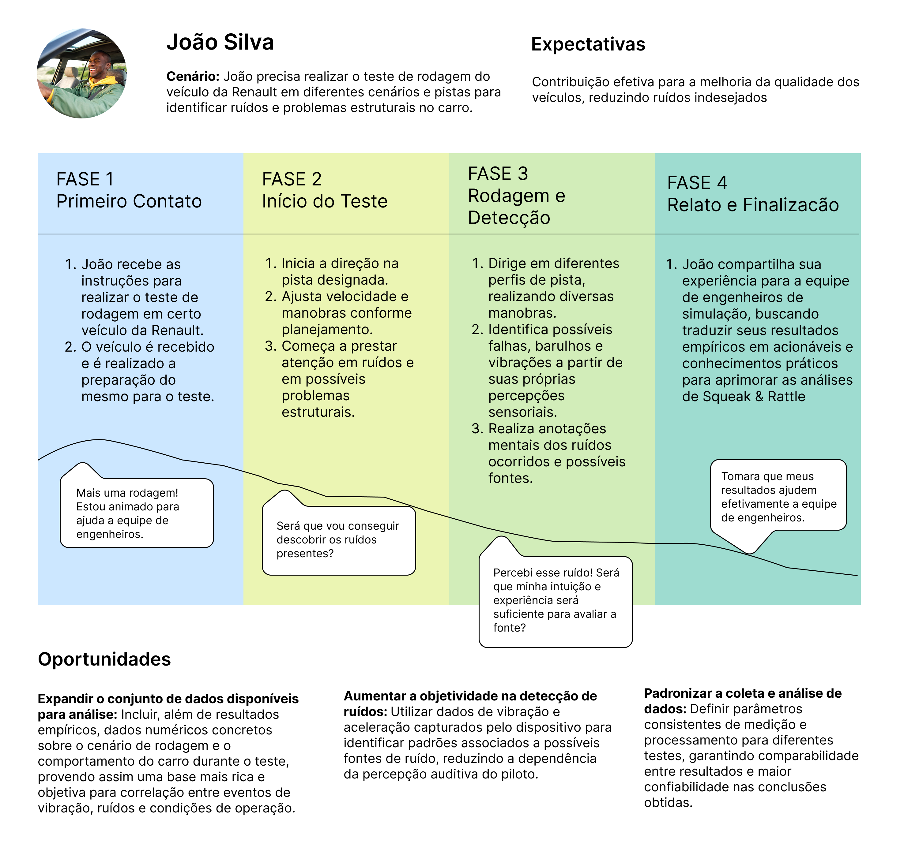
 Fonte: Material produzido pelos autores (2025) 

 

&nbsp;&nbsp;&nbsp;&nbsp;A jornada de João Silva antes da implementação da solução IoT é marcada por desafios que impactam a eficiência e a qualidade dos dados coletados durante os testes de Squeak and Rattle. Decidimos analisar a jornada antes da solução para identificar pontos críticos que poderiam ser aprimorados com a introdução do sistema Rythmo. Uma dessas oportunidades é integração de uma coleta de dados automatizada, isso é importante pois atualmente as análises de ruído e de problemas estruturais do veículo dependem inteiramente de observações subjetivas e percepções sensoriais do piloto, que podem levar a inconsistências e perda de informações valiosas. Introduzir uma camada de dados objetivos e mensuráveis, como aceleração e força, permitiria uma avaliação mais precisa e confiável dos problemas de Squeak and Rattle.

 

**Etapas da Jornada de João Silva (Depois da Solução):**

 Figura 8 - Jornada de João Silva (Depois da Solução) 
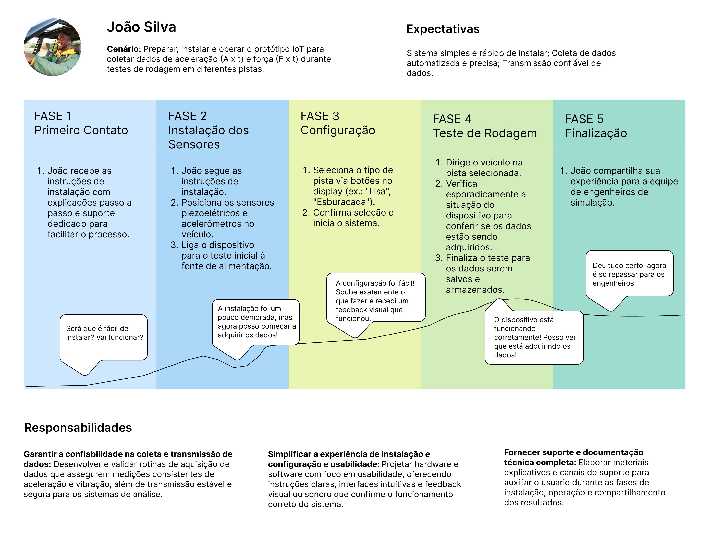
 Fonte: Material produzido pelos autores (2025) 

 

&nbsp;&nbsp;&nbsp;&nbsp; A jornada de João Silva após a implementação da solução IoT Rythmo apresenta melhorias significativas na eficiência e na qualidade dos dados coletados durante os testes de Squeak and Rattle. Com a introdução do sistema, João agora pode contar com uma coleta automatizada de dados de aceleração e força, eliminando a dependência exclusiva de observações subjetivas. Isso não apenas aumenta a precisão das análises, mas também permite que João e a equipe de engenharia identifiquem padrões e correlações que antes passariam despercebidos. 

 

**Jornada de usuário da Maria Oliveira (Depois da Solução):**

 Figura 9 - Jornada de Maria Oliveira (Depois da Solução) 
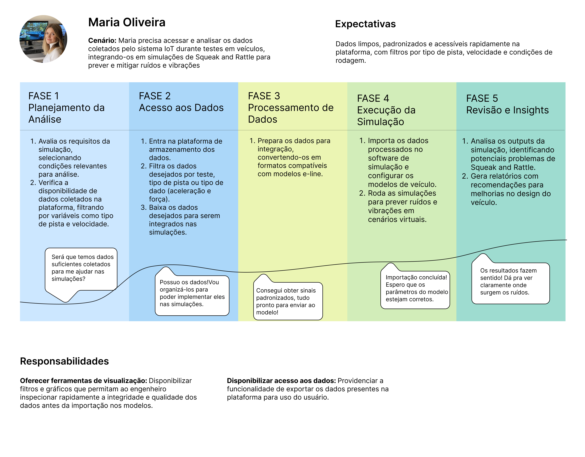
 Fonte: Material produzido pelos autores (2025) 

&nbsp;&nbsp;&nbsp;&nbsp;Além da jornada de João Silva, também mapeamos a jornada da engenheira de simulação Maria Oliveira, que desempenha um papel crucial na melhoria das simulações de Squeak and Rattle, utilizando os dados coletados pelo sistema IoT Rythmo dentro de seu fluxo de trabalho. O escopo do projeto abrange apenas até a fase 2, providenciando o acesso e a visualização dos dados pela plataforma, mas sentimos a necessidade de ir além e ilustrar a jornada completa dela, destacando a importância dos dados coletados para suas análises e simulações. Como esses dados serão utlizados na prática depende das ferramentas e processos internos da Renault, mas ao mapear essa jornada,conseguimos identificar claramente como a solução IoT impacta positivamente o trabalho de Maria, permitindo que ela realize análises mais precisas e fundamentadas, contribuindo para o desenvolvimento de veículos mais duráveis e confortáveis.

## 3.3. Solução Técnica	

 &nbsp;&nbsp;&nbsp;&nbsp;Nesta subseção, são feitos os detalhamentos em relação às especificações e capacidades téncicas do dispositivo IOT, delimitando-se seus requisitos funcionais e não funcionais, seu planejamento de arquitetura e demais características estruturais.

### 3.3.1. Requisitos Funcionais (sprint 1)	

 &nbsp;&nbsp;&nbsp;&nbsp;De acordo com Wiegers (2013) e Kotonya e Sommerville (1998), a Engenharia de Requisitos envolve a identificação e documentação de funcionalidades e constraints que um sistema deve satisfazer, capturando as demandas e perspectivas dos envolvidos no projeto. Esses requisitos classificam-se em funcionais, que definem as operações e comportamentos específicos que o software ou hardware precisa executar, e não funcionais, que estabelecem critérios de qualidade, como eficiência, interface, proteção de dados e acessibilidade. Os requisitos representam elementos fundamentais no ciclo de vida de produtos tecnológicos e exigem uma avaliação rigorosa, equilibrando as expectativas dos usuários com as viabilidades técnicas, visando a criação de soluções robustas, seguras e otimizadas.

 &nbsp;&nbsp;&nbsp;&nbsp;A seguir será detalhado os requisitos funcionais do projeto, seguindo a visão de funcionalidades, alinhados às demandas e problemas de negócios do parceiro Renault.

| **RF#** | **Descrição** | **Regra de negócio** | 
|----------|----------|----------|
|RF01|O sistema deve adquirir dados de aceleração (A x t) a partir de acelerômetros instalados no veículo durante ensaios em diferentes perfis de pista.|A aquisição de dados de aceleração deve ocorrer apenas durante a execução de testes veiculares padronizados, garantindo que os dados sejam coletados em condições controladas de rodagem para análises de Squeak and Rattle.|
|RF02|O sistema deve adquirir dados de força (F x t) a partir de sensores piezoelétricos instalados no veículo durante ensaios em diferentes perfis de pista.|A aquisição de dados de força deve ocorrer apenas durante a execução de testes veiculares padronizados, garantindo que os dados sejam coletados em condições controladas de rodagem para análises de Squeak and Rattle.|
|RF03|O sistema deve formatar os dados coletados (aceleração e força) em estruturas compatíveis com o protocolo MQTT, incluindo timestamps e identificadores de sensor.|Os dados formatados devem incluir metadados como perfil de pista, velocidade e identificador do teste, para permitir a rastreabilidade e correlação com condições específicas de rodagem veicular.|
|RF04|O sistema deve estabelecer uma conexão Wi-Fi com uma rede disponível para transmissão de dados.|A conexão Wi-Fi deve ser iniciada automaticamente ao ligar o dispositivo embarcado, priorizando redes pré-configuradas para ambientes de teste veicular na Renault ou proximidades do campus Inteli.|
|RF05|O sistema deve transmitir os dados formatados via protocolo MQTT para uma plataforma as a service configurada como endpoint.|A transmissão via MQTT deve ocorrer em tempo real durante os testes, utilizando tópicos específicos para separar dados de aceleração e força, garantindo a entrega para análises posteriores em projetos Renault.|
|RF06|O sistema deve permitir a definição de chaves de identificação de usuário (como API keys ou credenciais) para acesso seguro à plataforma de dashboard.|As chaves de identificação devem ser associadas a perfis de engenheiros da Renault ou equipe acadêmica, limitando o acesso apenas a stakeholders autorizados envolvidos no projeto de Squeak and Rattle.|
|RF07|O sistema deve permitir a definição e registro de devices (dispositivos IoT) dentro da plataforma as a service.|Cada device registrado deve ser vinculado a um veículo ou configuração de teste específica, permitindo o gerenciamento de múltiplos protótipos em diferentes pistas de rodagem.|
|RF08|O sistema deve armazenar os dados recebidos via MQTT em uma estrutura básica de banco de dados na plataforma as a service.|O armazenamento deve organizar os dados por teste, incluindo filtros por perfil de pista e velocidade, para facilitar a geração de bases de dados consistentes para simulações futuras de Squeak and Rattle.|
|RF09|O sistema deve fornecer representação gráfica dos dados coletados, incluindo gráficos de aceleração e força ao longo do tempo, no dashboard da plataforma.|As representações gráficas devem permitir visualização comparativa entre diferentes perfis de pista e velocidades, apoiando análises de criticidade e padrões de resposta veicular associados a ruídos de Squeak and Rattle.|
|RF10|O sistema deve permitir a exportação de dados armazenados em formatos como CSV ou JSON para análises externas.|A exportação deve ser restrita a usuários autenticados e deve incluir todos os metadados do teste, garantindo a reprodutibilidade em metodologias de simulação Renault.|
|RF11|O sistema deve permitir a configuração de parâmetros de aquisição, como taxa de amostragem dos sensores e duração dos testes.|As configurações devem ser aplicadas apenas antes do início de um teste, garantindo padronização para diferentes excitações veiculares e perfis de pista.

### 3.3.2. Requisitos Não Funcionais (sprint 2)	

Conforme Sommerville e Sawyer, requisitos não funcionais definem como o sistema opera e quais atributos de qualidade deve comprovar, abrangendo categorias de produto, organizacionais e externas. Segue a apresentação dos requisitos não funcionais, cada um mapeado à característica correspondente da ISO 25010 e acompanhado de método objetivo de verificação em ambiente controlado.

| **RNF#** | **Descrição** | **Aspecto de qualidade** | 
|----------|----------|----------|
|RNF01|Os dados coletados devem ser enviados ao armazenamento central mantendo cópia local. Se a rede estiver indisponível, os dados ficam guardados e são enviados automaticamente quando a conexão voltar. | Confiabilidade |
|RNF02|O tempo de envio de cada pacote do sensor para o armazenamento central deve ser de até sessenta segundos durante os testes. | Desempenho |
|RNF03|O dispositivo deve possuir capacidade de armazenamento local para pelo menos uma hora de coleta contínua de sinais. | Espaço |
|RNF04|O sistema deve gerar um registro de sessão com data e hora de início e de término, volume de dados gravados e estado do envio, disponível para consulta pelos times técnicos.| Operacional |
|RNF05|Os dados exportados devem ser fáceis de localizar e entender por novos usuários. Adotar estrutura de pastas simples por data e sessão, nomes de arquivo padronizados| Usabilidade |

#### **RNF01 - Os dados coletados devem ser enviados ao armazenamento central mantendo cópia local. Se a rede estiver indisponível, os dados ficam guardados e são enviados automaticamente quando a conexão voltar.**

Este requisito garante continuidade de coleta e proteção do histórico, evitando perda de informação durante testes e coletas em campo. Suporta comparações entre campanhas e dá previsibilidade ao fluxo de trabalho técnico.
Como validar. Simular ausência de rede durante a coleta, confirmar a gravação local dos arquivos e verificar o envio automático após o retorno da conexão, conferindo contagem de registros e integridade no destino.

#### **RNF02 - O tempo de envio de cada pacote do sensor para o armazenamento central deve ser de até sessenta segundos durante os testes.**
Define um limite claro para o tempo de entrega dos dados, permitindo uso rápido pelas equipes e respostas mais ágeis em rotinas de engenharia.
Como validar. Marcar horários no ponto de captura e no recebimento no repositório, executar sessões controladas e confirmar que os tempos medidos permanecem dentro de sessenta segundos.

#### **RNF03 - O dispositivo deve possuir capacidade de armazenamento local para pelo menos uma hora de coleta contínua de sinais.**

Assegura que a coleta prossiga mesmo sem conectividade, cobrindo janelas de oscilação de rede ou deslocamentos operacionais, sem interrupções.
Como validar. Realizar uma sessão contínua de uma hora com a rede desligada, verificar a presença e a integridade dos arquivos locais e confirmar que não houve truncamentos.

#### **RNF04 - O sistema deve gerar um registro de sessão com data e hora de início e de término, volume de dados gravados e estado do envio, disponível para consulta pelos times técnicos.**

Fornece rastreabilidade e visibilidade do processo, facilitando auditoria, suporte e comparação entre sessões e veículos.
Como validar. Encerrar uma sessão e verificar a criação do registro correspondente, conferindo consistência entre horários, volume gravado e status de entrega no armazenamento central.

#### **RNF05 - Os dados exportados devem ser fáceis de localizar e entender por novos usuários. Adotar estrutura de pastas simples por data e sessão, nomes de arquivo padronizados.**

Promove organização e acessibilidade, reduzindo tempo de busca e a necessidade de treinamento para quem inicia no projeto.
Como validar. Solicitar a usuários novos que localizem uma sessão específica e abram o arquivo correto, medindo tempo de execução e taxa de acerto na primeira tentativa.

### 3.3.3. Arquitetura da Solução (sprint 3)

_Vídeo de explicação sobre a arquitetura da solução: (coloque aqui o link do vídeo)_

_Descreva a arquitetura técnica da solução de forma detalhada (visão de arquitetura).

Justifique como a arquitetura suporta os requisitos funcionais e não funcionais.

O diagrama de arquitetura deve:_
- _Mostrar microcontroladores, incluindo descrições de sua função no sistema (por exemplo: "Irá processar o sinal dos sensores a cada X minutos")_
- _Mostrar sensores, incluindo descrição de função e especificações técnicas do tipo de informação que será coletada_
- _Mostrar apresentadores de informação (displays), incluindo descrição de que tipo de informação será apresentada (por exemplo, "Mostrar temperatura dos sensores")_
- _Mostrar atuadores, caso existam na solução, incluindo descrições do que irão acionar (por exemplo, "Ligar motor de irrigação durante x minutos")_
- _Mostrar o broker MQTT e o dashboard que é a interface do usuário_
- _Mostrar ligações entre os elementos (com fio ou sem fio) – incluindo conexões com sensores e atuadores, conexão com WiFi, entre outros_

### 3.3.4. Arquitetura do Protótipo(sprint 4)	

_Vídeo de explicação sobre a arquitetura do protótipo físico: (coloque aqui o link do vídeo)_

_Descreva as tecnologias utilizadas de forma detalhada (visão de tecnologia).

Descreva a arquitetura usando um diagrama de blocos similar à visão anterior, porém especificando as tecnologias utilizadas. O diagrama de arquitetura deve:_
- _Mostrar microcontroladores, incluindo descrições de sua função no sistema (por exemplo: "Irá processar o sinal dos sensores a cada X minutos")_
- _Mostrar sensores, incluindo descrição de função e especificações técnicas do tipo de informação que será coletada_
- _Mostrar apresentadores de informação (displays), incluindo descrição de que tipo de informação será apresentada (por exemplo, "Mostrar temperatura dos sensores")_
- _Mostrar atuadores, caso existam na solução, incluindo descrições do que irão acionar (por exemplo, "Ligar motor de irrigação durante x minutos")_
- _Mostrar o broker MQTT e o dashboard que é a interface do usuário_
- _Mostrar ligações entre os elementos (com fio ou sem fio) – incluindo conexões com sensores e atuadores, conexão com WiFi, entre outros._
_Faça uma tabela dos possíveis componentes utilizados. Todos os componentes devem estar presentes na arquitetura._

| **Componente** | **Descrição** | **Tipo** | 
|----------|----------|----------|
|E.g. ESP32 WROOM 32 Devkit|E.g. Trata-se de um microcontrolador amplamente usado na indústria e em projetos educacionais, que possui interfaces mais amigáveis para conexão de componentes diversos...|E.g. Microcontrolador|
|E.g. sensor XPTO|E.g. Este sensor mede o sinal de XYZ em unidades q/s, e possui tolerância de abcd...|E.g. Sensor|

### 3.3.5. Arquitetura Refinada da Solução (sprint 5)	

_Descreva a revisão da arquitetura técnica da solução de forma detalhada (visão de arquitetura).  

Justifique como a arquitetura suporta os requisitos funcionais e não funcionais.  

A revisão deverá incluir comentários sobre cada ponto levantado, mostrando como os ajustes foram realizados, além da descrição da arquitetura revisada._

## 3.4. Resultados	

_Nesta seção, detalhe os resultados obtidos com a implementação, de acordo com o disposto nas subseções._

### 3.4.1.Protótipo Inicial do Projeto usando o Simulador Wokwi (sprint 1)

De acordo com a documentação oficial, o Wokwi é uma plataforma de simulação eletrônica online e gratuita, que permite simular o uso de diversos componentes eletrônicos em conjunto com microcontroladores como o ESP32 e o Arduino. A finalidade de se utilizar essa ferramenta está na necessidade de testar o hardware e os componentes eletrônicos em conjunto com toda a programação antes de iniciar de fato a montagem física do circuito. Em projetos de eletrônica, é comum que a prototipagem passe por três etapas: simulação, prototipação em protoboard e, por fim, design de placa de circuito impresso.

 Dessa forma, no contexto do nosso projeto, a utilização do Wokwi foi essencial para testar a funcionalidade do sensor MPU6050, que é um acelerômetro e giroscópio, integrado ao microcontrolador ESP32. Entretanto na plataforma Wokwi, não havia disponivel um sensor piezoelétrico, com orientação do professor, foi decidido utilizar um potenciômetro como alternativa, pois ele poderia simular variações de tensão de forma semelhante ao sensor piezoelétrico. Isso permitiu testar tanto o código quanto o comportamento dos componentes em um ambiente virtual controlado, reduzindo riscos e tempo para o desenvolvimento do protótipo físico.

[Link para o protótipo inicial no Wokwi](https://wokwi.com/projects/445451718509901825)

Após o desenvolvimento da simulação no Wokwi, realizamos alguns casos de teste. Nessa etapa, avaliamos as funcionalidades dos componentes em diferentes cenários, incluindo tanto casos de sucesso quanto situações com erros de leitura. O principal objetivo dessa fase é avaliar o comportamento do nosso sistema e, assim, garantir seu bom funcionamento, evitando riscos de falhas futuras na implementação física.

Casos de Teste 

**#** | **Bloco** | **Componente de entrada** | **Leitura da entrada** | **Componente de saída** | **Leitura da saída** | **Descrição**
|----------|----------|----------|----------|----------|----------|----------|
|01|Aceleração no eixo X| Sensor MPU6050 | 1g | Display LCD I2C | "X: 9.81"  em uma parte do display LCD | Quando o sensor detecta uma aceleração de 1g no eixo X, o display LCD I2C exibe o valor correspondente de 9.81 m/s².|
|02|Aceleração no eixo X| Sensor MPU6050 | 0g | Display LCD I2C | "X: 0.00"  em uma parte do display LCD | Quando o sensor detecta uma aceleração de 0g no eixo X, o display LCD I2C exibe o valor correspondente de 0.00 m/s².|
|03|Aceleração no eixo X| Sensor MPU6050 | -1g | Display LCD I2C | "X: -9.81"  em uma parte do display LCD | Quando o sensor detecta uma aceleração de -1g no eixo X, o display LCD I2C exibe o valor correspondente de -9.81 m/s².|
|04|Aceleração no eixo Y| Sensor MPU6050 | 1g | Display LCD I2C | "Y: 9.81" em uma parte do display LCD | Quando o sensor detecta uma aceleração de 1g no eixo Y, o display LCD I2C exibe o valor correspondente de 9.81 m/s².|
|05|Aceleração no eixo Y| Sensor MPU6050 | 0g | Display LCD I2C | "Y: 0.00" em uma parte do display LCD | Quando o sensor detecta uma aceleração de 0g no eixo Y, o display LCD I2C exibe o valor correspondente de 0.00 m/s².|
|06|Aceleração no eixo Y| Sensor MPU6050 | -1g | Display LCD I2C | "Y: -9.81" em uma parte do display LCD | Quando o sensor detecta uma aceleração de -1g no eixo Y, o display LCD I2C exibe o valor correspondente de -9.81 m/s².|
|07|Aceleração no eixo Z| Sensor MPU6050 | 1g | Display LCD I2C | "Z: 9.81" em uma parte do display LCD | Quando o sensor detecta uma aceleração de 1g no eixo Z, o display LCD I2C exibe o valor correspondente de 9.81 m/s².|
|08|Aceleração no eixo Z| Sensor MPU6050 | 0g | Display LCD I2C | "Z: 0.00" em uma parte do display LCD | Quando o sensor detecta uma aceleração de 0g no eixo Z, o display LCD I2C exibe o valor correspondente de 0.00 m/s².|
|09|Aceleração no eixo Z| Sensor MPU6050 | -1g | Display LCD I2C | "Z: -9.81" em uma parte do display LCD | Quando o sensor detecta uma aceleração de -1g no eixo Z, o display LCD I2C exibe o valor correspondente de -9.81 m/s².|
|10|Variação do Potenciômetro| Potenciômetro | 0 | Display LCD I2C | "V: 0.00" em uma parte do display LCD | Quando o potenciômetro detecta o valor de 0, o display LCD I2C exibe o valor correspondente de 0.00.|
|11|Variação do Potenciômetro| Potenciômetro | 4095 | Display LCD I2C | "V: 4095" em uma parte do display LCD | Quando o potenciômetro detecta o valor de 4095, o display LCD I2C exibe o valor correspondente de 4095.|
|12|Troca de opção de pista|Botão Options|Botão pressionado (LOW)|Display LCD I2C|Texto da pista muda para próxima opção|Ao pressionar o botão de opções, o display alterna entre "Lisa", "Esburacada", "Paralelepipedo", "Placeholder", "Placeholder2".|
|13|Seleção de pista|Botão Select |Botão pressionado (LOW)|Display LCD I2C|Texto muda para "Selected Pista:" e mostra pista escolhida|Ao pressionar o botão de seleção, a pista atual é marcada como selecionada e o display exibe "Selected Pista:" na linha superior.|
|14|Reset de seleção|Botão Reset |Botão pressionado (LOW)|Display LCD I2C|Display volta a mostrar "Select Pista:" e opção atual|Ao pressionar o botão de reset, a seleção é desfeita e o display retorna ao estado inicial de escolha de pista.|
|15|Ciclo de opções|Botão Options |Botão pressionado repetidas vezes|Display LCD I2C|Opções voltam para "Lisa" após "Placeholder2"|Ao pressionar o botão de opções cinco vezes, o display retorna para a primeira opção ("Lisa"), reiniciando o ciclo.|
|16|Seleção bloqueada|Botão Options após seleção|Botão pressionado (LOW)|Display LCD I2C|Opção não muda após seleção|Após selecionar uma pista, pressionar o botão de opções não altera mais a pista até que o reset seja realizado.|
|17|Inicio bloqueado|Botão Start sem seleção|Botão pressionado (LOW)|Display LCD I2C|Medições não iniciam|Ao pressionar o botão de start sem uma pista selecionada, as medições não são iniciadas.|
|18|Inicio após seleção|Botão Start com seleção|Botão pressionado (LOW)|Display LCD I2C|Medições iniciam e são exibidas|Ao pressionar o botão de start após selecionar uma pista, as medições começam a ser exibidas no display.|
|19|Reset após início|Botão Reset após start|Botão pressionado (LOW)|Display LCD I2C|Medições param e display volta ao estado inicial|Ao pressionar o botão de reset após iniciar as medições, o display retorna ao estado inicial de escolha de pista.|

Fonte: Material produzido pelos autores (2025)

- Teste 01, 04, 07: Verificação das leituras de aceleração positiva nos eixos X, Y e Z.

   
Caso 1: Aceleração positiva

   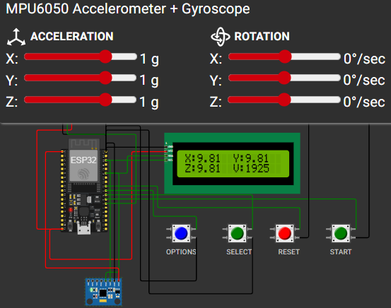 
   
Fonte: Material produzido pelos autores (2025)
   

- Teste 02, 05, 08: Verificação das leituras de aceleração nula nos eixos X, Y e Z.

   Caso 2: Aceleração nula

   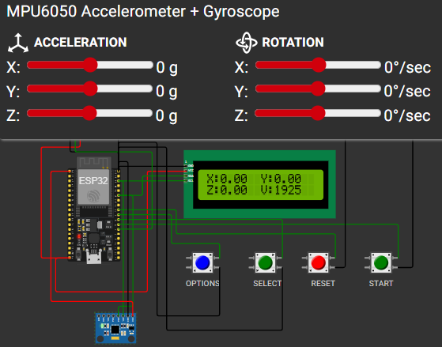 

   Fonte: Material produzido pelos autores (2025)

- Teste 03, 06, 09: Verificação das leituras de aceleração negativa nos eixos X, Y e Z.

   Caso 3: Aceleração negativa

   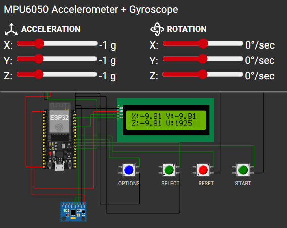 

   Fonte: Material produzido pelos autores (2025)

- Teste 10, 11: Verificação das leituras do potenciômetro em seus valores extremos (0 e 4095).

   Caso 4: Leitura do potenciômetro no valor minimo

   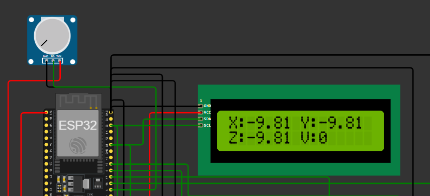 

   Fonte: Material produzido pelos autores (2025)

   Caso 5: Leitura do potenciômetro no valor máximo

   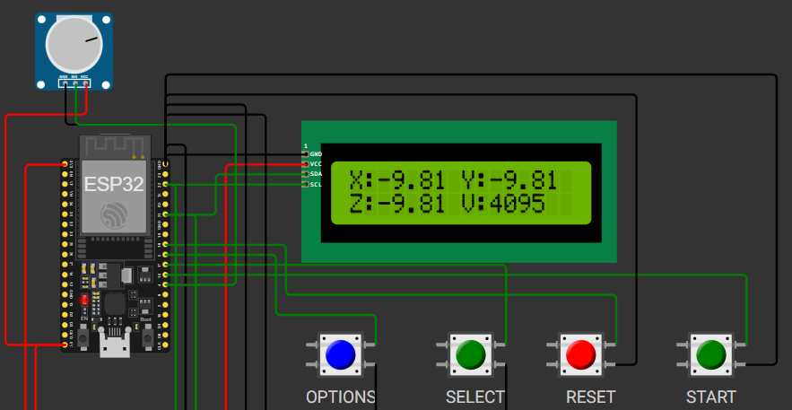 

   Fonte: Material produzido pelos autores (2025)

- Teste 12, 13, 14, 15, 16, 17, 18 e 19: Verificação do funcionamento dos botões de opções, seleção, reset e start.

&emsp;Para uma melhor demonstração dos casos 12, 13, 14, 15, 16, 17, 18 e 19, foi gravado um vídeo desses testes no simulador, que está disponível no link abaixo:

&emsp;Clique [aqui](https://drive.google.com/file/d/1boN18v-9LacVXzaJGFAZLGGOmYxoMpKp/view?usp=sharing) para acessar o vídeo.

&emsp; O vídeo demonstra algumas inconsistencias no caso 15, onde o botão de opções volta para a primeira opção após a quinta opção aparecer duas vezes. Entretanto, todos os outros casos de teste funcionaram conforme o esperado, validando o funcionamento do protótipo simulado.

&emsp;Dessa forma, após todo o processo de simulação e realização dos casos de teste, obtivemos uma visão mais clara do protótipo a ser desenvolvido. Esse processo permite identificar possíveis erros e limitações, oferecendo a oportunidade de aprimorar o sistema antes da implementação física. Assim, conseguimos reduzir riscos e aumentar a eficiência no desenvolvimento do projeto.

### 3.4.2. Protótipo Físico do Projeto (offline) (sprint 2)	

&nbsp;&nbsp;&nbsp;&nbsp;A execução regular e sistemática dos casos de teste é fundamental para assegurar a robustez, a confiabilidade e o desempenho dos dispositivos eletrônicos, como o protótipo offline da Renault, desenvolvido neste projeto. Dando continuidade às avaliações realizadas na sprint inicial, esta fase de testes físicos tem como objetivo identificar e corrigir falhas em diferentes estágios de construção do protótipo, garantindo que o dispositivo funcione conforme o esperado em diversos cenários, inclusive nas condições mais adversas.

&nbsp;&nbsp;&nbsp;&nbsp;Esses registros experimentais, acompanhados de figuras ilustrativas do protótipo físico e descrições detalhadas das situações testadas, permitem compreender o comportamento do sistema em operação e validar sua integração entre hardware e software. Em síntese, tais procedimentos reduzem a probabilidade de falhas futuras, promovendo melhorias antecipadas antes da adoção em ambientes reais e reforçando o compromisso com a excelência e a confiabilidade do protótipo offline da Renault.

A seguir, são apresentados os principais cenários de teste executados: 

| #  | Descrição | Pré-condição | Procedimento de teste | Pós-condição/Resultado esperado | Observações (opcional) |
|----|------------|---------------|------------------------|----------------------------------|------------------------|
| 01 | Verificação da funcionalidade básica do sensor piezoelétrico ao aplicar pressão. | Protótipo montado e alimentado via USB ou bateria, em ambiente controlado sem pressões externas. | Aplicar uma pressão leve no sensor (ex: batida com o dedo) e observar a resposta no LCD. Repetir com pressão nula para verificar falsos positivos. | O LCD exibe o valor detectado ou indicação de pressão; sem detecções em repouso. | Teste bem sucedido |
| 02 | Avaliação do tempo de resposta do sensor piezoelétrico em ambiente controlado. | Protótipo montado e alimentado; ferramentas de medição de tempo disponíveis. | Aplicar pressão controlada e medir o tempo até a atualização no LCD. | O sensor responde em menos de 1 segundo, com o LCD exibindo o valor detectado. | Teste bem sucedido |
| 03 | Medição da intensidade de pressão detectada pelo sensor piezoelétrico. | Protótipo montado e alimentado; serial monitor ou LCD para leitura. | Aplicar pressões de intensidades variadas (baixa, média, alta) e registrar os valores exibidos no LCD. | O LCD exibe valores entre 0 e 4095, com valores mais altos indicando pressões mais fortes. | Teste bem sucedido |
| 04 | Verificação da funcionalidade dos botões para navegação (OPTIONS, SELECT, RESET, START). | Protótipo montado e alimentado; LCD visível. | Pressionar cada botão individualmente e observar a resposta no LCD (ex: navegação de menu, seleção, reset ou início). | Cada botão aciona a função correspondente; LCD atualiza imediatamente sem falhas. | Teste bem sucedido |
| 05 | Avaliação da integração entre sensor piezoelétrico, botões e LCD em fluxo completo. | Protótipo montado e alimentado; menu inicial no LCD. | Usar botões para navegar (OPTIONS/SELECT), aplicar pressão no sensor, usar START para iniciar e RESET para reiniciar; verificar fluxo. | O sistema responde a inputs combinados; LCD mostra estados corretos. | Teste bem sucedido |
| 06 | Verificação da funcionalidade básica do acelerômetro ao aplicar movimento. | Protótipo montado e alimentado via USB ou bateria, em ambiente controlado sem movimentos externos. | Aplicar um movimento leve no protótipo (ex: inclinação ou agitação) e observar a resposta no LCD. Repetir em repouso para verificar falsos positivos. | O LCD exibe os valores de aceleração detectados nos eixos (X, Y, Z); sem detecções em repouso. | Teste bem sucedido |
| 07 | Avaliação do tempo de resposta do acelerômetro em ambiente controlado. | Protótipo montado e alimentado; ferramentas de medição de tempo disponíveis. | Aplicar movimento controlado e medir o tempo até a atualização no LCD. | O acelerômetro responde em menos de 1 segundo, com o LCD exibindo os valores detectados. | Teste bem sucedido |
| 08 | Medição da aceleração em diferentes eixos detectada pelo acelerômetro. | Protótipo montado e alimentado; serial monitor ou LCD para leitura. | Aplicar movimentos em direções variadas (ex: eixo X, Y, Z) e registrar os valores exibidos no LCD. | O LCD exibe valores de aceleração (ex: em g), com variações correspondentes aos eixos movimentados. | Teste bem sucedido |
| 09 | Avaliação da integração entre acelerômetro, botões e LCD em fluxo completo. | Protótipo montado e alimentado; menu inicial no LCD. | Usar botões para navegar (OPTIONS/SELECT), aplicar movimento no acelerômetro, usar START para iniciar e RESET para reiniciar; verificar fluxo. | O sistema responde a inputs combinados; LCD mostra estados corretos baseados na aceleração. | Teste bem sucedido |
| 10 | Verificação do LED vermelho piscando antes da inicialização do protótipo. | Protótipo montado e alimentado; LED vermelho conectado corretamente. | Ligar o protótipo e observar se o LED vermelho pisca em intervalo regular antes do sistema iniciar. | LED vermelho pisca continuamente até o sistema completar a inicialização. | Teste bem sucedido |
| 11 | Verificação do LED verde aceso durante o funcionamento do protótipo. | Protótipo montado e inicializado completamente; LED verde conectado. | Após a inicialização, observar se o LED verde permanece aceso enquanto o sistema está em operação. | LED verde permanece aceso sem oscilações durante todo o funcionamento. | Teste bem sucedido |

&emsp;Clique [aqui](https://drive.google.com/file/d/1H7OradsyvV5FF7lPTnLamWB38_OL46gR/view?usp=sharing) para acessar o vídeo do Teste 1 e 2.

   Caso 2: Tempo de resposta do piezoelétrico

   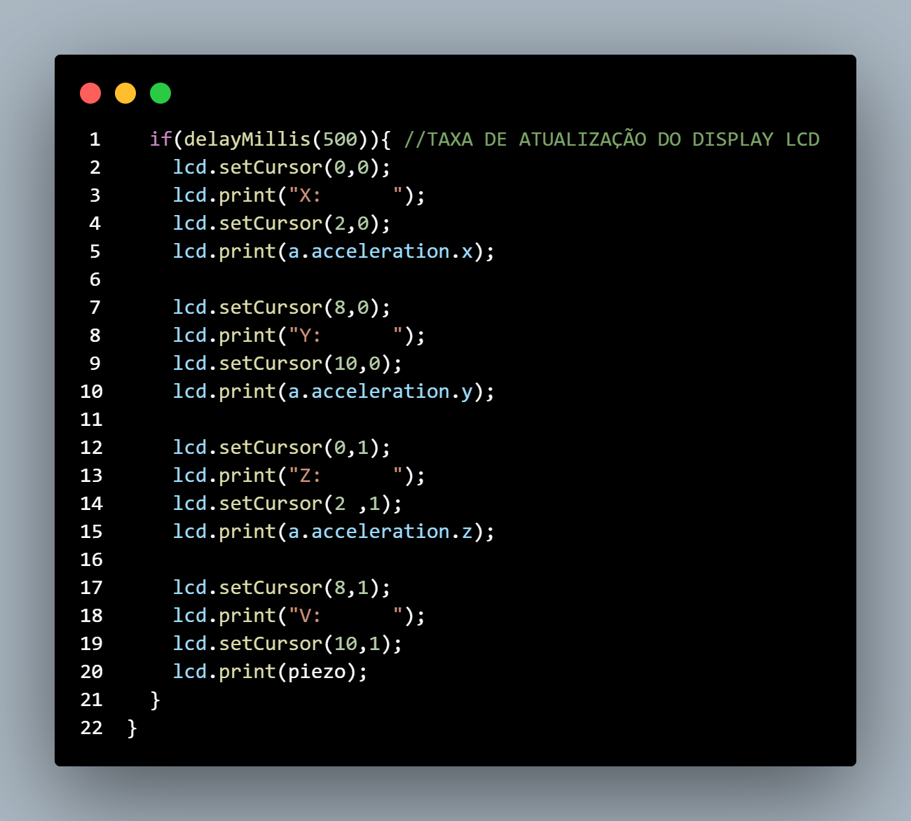 

   Fonte: Material produzido pelos autores (2025)

&emsp;Clique [aqui](https://drive.google.com/file/d/1jhpy7zYRdn-DrL0kTzzQBVcE3D5SslYJ/view?usp=sharing) para acessar o vídeo do Teste 3.

&emsp;Clique [aqui](https://drive.google.com/file/d/1g-3X5NSEkF6hV3FLrjkUKlLqdsbMYvWF/view?usp=sharing) para acessar o vídeo do Teste 4.

&emsp;Clique [aqui](https://drive.google.com/file/d/1JR1xGoF4nzgvLgu4W3-mfu44JB3WSumL/view?usp=sharing) para acessar o vídeo do Teste 5.

&emsp;Clique [aqui](https://drive.google.com/file/d/1SUi_PPNBBSeCTeTKtpvOFWUtANgu0Hy_/view?usp=sharing) para acessar o vídeo do Teste 6, 7 e 8.

&emsp;Clique [aqui](https://drive.google.com/file/d/1tHVRKewaWchrnVr7DmiwzDFTH7W5hcSS/view?usp=sharing) para acessar o vídeo do Teste 9.

&emsp;Clique [aqui](https://drive.google.com/file/d/1HWoo3YmrQKnCQ3tpl2Ot0ewT7RNkMUaB/view?usp=sharing) para acessar o vídeo do Teste 10 e 11.

### Análise descritiva dos testes:

&emsp;&emsp;&emsp;&emsp;**Teste 01:** Verificação da funcionalidade básica do sensor piezoelétrico ao aplicar pressão.
No teste, montei o protótipo e o alimentei via USB em um local sem pressões. Bati levemente com o dedo no sensor piezoelétrico, e o LCD mostrou imediatamente uma indicação de pressão com o valor detectado. Depois, deixei em repouso por alguns segundos, e nada apareceu no LCD, sem falsos positivos.

&emsp;&emsp;&emsp;&emsp;**Teste 02:** Avaliação do tempo de resposta do sensor piezoelétrico em ambiente controlado.
Com o protótipo montado e ligado, usei um cronômetro para medir o tempo. Apliquei uma pressão controlada batendo no sensor, e cronometrei até o LCD atualizar com o valor que levou menos de 1 segundo, como esperado.

&emsp;&emsp;&emsp;&emsp;**Teste 03:** Medição da intensidade de pressão detectada pelo sensor piezoelétrico.
Liguei o protótipo e usei o LCD para ler os valores. Apliquei pressões leves (batida fraca), médias (batida normal) e altas (batida forte), anotando os números no LCD: valores baixos em torno de 500 para leves, até 3000 para altas, confirmando que números maiores indicam pressões mais fortes.

&emsp;&emsp;&emsp;&emsp;**Teste 04:** Verificação da funcionalidade dos botões para navegação (OPTIONS, SELECT, RESET, START).
Com o protótipo ligado e o LCD visível, pressionei cada botão um por um: OPTIONS mudou as opções no menu, SELECT confirmou a escolha, RESET voltou ao início, e START iniciou a função. O LCD atualizou na hora sem erros.

&emsp;&emsp;&emsp;&emsp;**Teste 05:** Avaliação da integração entre sensor piezoelétrico, botões e LCD em fluxo completo.
Iniciei no menu do LCD com o protótipo ligado. Usei OPTIONS e SELECT para navegar, bati no sensor para simular input, pressionei START para começar o processo, e RESET para reiniciar tudo. O LCD mostrou os estados corretos em cada passo, integrando tudo sem problemas.

&emsp;&emsp;&emsp;&emsp;**Teste 06:** Verificação da funcionalidade básica do acelerômetro ao aplicar movimento.
Monte o protótipo e liguei via bateria em um lugar parado. Inclinei levemente o dispositivo para simular movimento, e o LCD exibiu valores de aceleração nos eixos X, Y e Z. Em repouso, os valores ficaram zerados, sem falsos positivos.

&emsp;&emsp;&emsp;&emsp;**Teste 07:** Avaliação do tempo de resposta do acelerômetro em ambiente controlado.
Com o protótipo ligado e cronômetro pronto, agitei o dispositivo de forma controlada e medi o tempo até o LCD atualizar os valores de aceleração que foi menos de 1 segundo, com os dados aparecendo corretamente.

&emsp;&emsp;&emsp;&emsp;**Teste 08:** Medição da aceleração em diferentes eixos detectada pelo acelerômetro.
Liguei o protótipo e observei o LCD. Movi o dispositivo no eixo X (esquerda-direita), Y (frente-trás) e Z (cima-baixo), registrando os valores em g no LCD, que variaram conforme a direção do movimento.

&emsp;&emsp;&emsp;&emsp;**Teste 09:** Avaliação da integração entre acelerômetro, botões e LCD em fluxo completo.
Com o menu inicial no LCD, usei OPTIONS e SELECT para navegar, agitei o acelerômetro para input de movimento, pressionei START para iniciar e RESET para reiniciar. O LCD atualizou os estados baseados na aceleração, respondendo bem aos inputs combinados.

&emsp;&emsp;&emsp;&emsp;**Teste 10:** Verificação do LED vermelho piscando antes da inicialização do protótipo.
Monte o protótipo com o LED vermelho conectado e liguei. Observei o LED piscando em intervalos regulares enquanto o sistema carregava, e ele parou de piscar só depois da inicialização completa.

&emsp;&emsp;&emsp;&emsp;**Teste 11:** Verificação do LED verde aceso durante o funcionamento do protótipo.
Após ligar e inicializar o protótipo com o LED verde conectado, verifiquei que ele ficou aceso o tempo todo durante a operação, sem piscar ou apagar, enquanto usava as funções normais.

&emsp;&emsp;&emsp;&emsp;Em resumo, os testes detalhados no protótipo offline da Renault foram muito importantes para confirmar seu bom funcionamento e resistência em várias situações. Fazer esses testes ajudou a equipe a encontrar e consertar erros no hardware e no software, principalmente nos botões, na leitura dos sensores e na reação do dispositivo em condições diferentes.

### 3.4.3. Protótipo do Projeto com MQTT e I2C (sprint 3)	

_Aqui você deve registrar diversas situações de uso de seu sistema como um todo, indicando exemplos de ação do usuário e resposta do sistema, apontando como o ambiente deverá estar configurado para receber a ação e produzir a resposta. Estes registros serão utilizados para testar seu sistema, portanto, descreva várias situações, incluindo não apenas casos de sucesso, mas também de falha nos comportamentos do sistema.  
Siga as nomenclaturas e convenções já utilizadas anteriormente, e não se esqueça dos alinhamentos de negócios e experiência do usuário para pensar em situações representativas. Inclua figuras do protótipo físico e dashboards, além de descrições dos testes realizados para ilustrar o funcionamento do protótipo. A tabela a seguir serve como exemplo._

**#** | **Configuração do ambiente** | **Ação do usuário** | **Resposta esperada do sistema** 
|----------|----------|----------|----------|
|01|ex. precisa de um computador conectado na interface, dois ou mais dispositivos que simulem o posicionamento de um item X no espaço físico etc. | ex. usuário logado busca a localização do item X, que está ativo e operando normalmente | ex. interface do sistema acessa os dados da última localização registrada do item X e apresenta, constando local e horário de última atualização | 

### 3.4.4. Protótipo Físico do Projeto (online) (sprint 4)	

_Aqui você deve registrar diversas situações de uso de seu sistema como um todo, indicando exemplos de ação do usuário e resposta do sistema, apontando como o ambiente deverá estar configurado para receber a ação e produzir a resposta. Estes registros serão utilizados para testar seu sistema, portanto, descreva várias situações, incluindo não apenas casos de sucesso, mas também de falha nos comportamentos do sistema.  
**Desta vez, utilize diagramas de sequência UML para descrever os fluxos de teste do sistema.**  
Siga as nomenclaturas e convenções já utilizadas anteriormente, e não se esqueça dos alinhamentos de negócios e experiência do usuário para pensar em situações representativas. Inclua figuras do protótipo físico e dashboards, além de descrições dos testes realizados para ilustrar o funcionamento do protótipo._

### 3.4.5. Protótipo Final do Projeto (sprint 5)	

_Registre as situações de uso do sistema revisadas utilizando a modelagem UML para descrever os fluxos de teste.  
Também inclua figuras da versão final do protótipo físico e dashboards, além de descrições dos testes realizados para ilustrar o funcionamento do protótipo._

## 4. Conclusões e Recomendações

_Escreva, de forma resumida, sobre os principais resultados do seu projeto e faça recomendações formais ao seu parceiro de projeto em relação ao uso dessa solução. Você pode aproveitar este espaço para comentar sobre possíveis materiais extras._

## 5. Referências

SAPEGA, Marissa. What is a storyboard? CareerFoundry, [s.l.], [s.d.]. Disponível em: https://careerfoundry.com/en/blog/ui-design/what-is-a-storyboard/#what-is-a-storyboard. Acesso em: 1 nov. 2025.

INVESTOPEDIA. Porter’s 5 Forces: Definition and Examples. Disponível em: https://www.investopedia.com/terms/p/porter.asp. Acesso em: 23 out. 2025.

PORTER, Michael E. Competitive strategy: techniques for analyzing industries and competitors. New York: Free Press, 2008.

OSTERWALDER, A.; PIGNEUR, Y.; BERNARDA, G.; SMITH, A. *Value Proposition Design: How to Create Products and Services Customers Want.* Wiley, 2014.

KEVIN DUNNE. SWOT Analysis: Strengths, Weaknesses, Opportunities and Threats (ou título equivalente em inglês conforme aparece na página). Mind Tools, sem data explícita de publicação (s.d.). Acesso em: 19 out. 2025.

BRUTON, Louise. What are UX personas and what are they used for? UX Design Institute, 2022. Disponível em: https://www.uxdesigninstitute.com/blog/what-are-ux-personas/. Acesso em: 19 out. 2025.

KOTONYA, Gerald; SOMMERVILLE, Ian. Requirements engineering: processes and techniques. Chichester: J. Wiley, 1998.

WIEGERS, Karl; BEATTY, Joy. Software requirements. 3. ed. Redmond: Microsoft Press, 2013.

TOMAZ, R.; GAGLIASSO, F.; MALAVOTA, G. Gestão de riscos em projetos de engenharia. São Paulo: Atlas, 2020.

GIBBONS, S. Journey Mapping 101. Nielsen Norman Group, 2018. Disponível em: https://www.nngroup.com/articles/journey-mapping-101/. Acesso em: 5 nov. 2025.

## 6. Anexos

### 6.1. Análise Experimental de Circuito RC

Nesta seção, apresentamos uma análise experimental detalhada de um circuito RC (resistor-capacitor) para validar os conceitos teóricos relacionados à constante de tempo e ao comportamento dinâmico do circuito. O objetivo é comparar os resultados experimentais com as previsões teóricas, destacando quaisquer discrepâncias e discutindo suas possíveis causas.

#### 6.1.1. Fundamentação Teórica

Um circuito RC é um circuito elétrico composto por um resistor (R) e um capacitor (C) conectados em série ou paralelo. É um dos circuitos mais básicos e importantes na análise de circuitos, servindo como filtro, temporizador ou elemento de armazenamento de energia.

A tensão no capacitor em um circuito RC segue comportamentos diferentes dependendo se está carregando ou descarregando:

Durante o carregamento (capacitor inicialmente descarregado conectado a uma fonte V₀):

$$V_C(t) = V_f \cdot (1 - e^{-t/RC})$$

Onde:

- $V_C(t)$ é a tensão no capacitor no instante $t$
- $V_f$ é a tensão da fonte
- $e$ é a base do logaritmo natural (≈ 2,718)
- $t$ é o tempo
- $RC (\tau)$ é a constante de tempo (produto da resistência e capacitância) 

O capacitor começa em 0V e cresce exponencialmente até atingir $V_f$.

Durante o descarregamento (capacitor inicialmente carregado com tensão $V_f$):

$$V_C(t) = V_f \cdot e^{-t/RC}$$

O capacitor começa em $V_f$ e decai exponencialmente até 0V.

A constante de tempo é o parâmetro mais importante do circuito RC, definida como:
$$\tau = R \times C$$
Onde:

$\tau$ (tau) é a constante de tempo em segundos

$R$ é a resistência em ohms (Ω)

$C$ é a capacitância em farads (F)

Significado físico:

A constante de tempo representa o tempo necessário para que a tensão no capacitor atinja aproximadamente 63,2% do seu valor final durante o carregamento (ou decaia para 36,8% do valor inicial durante o descarregamento).
Regra prática:
  
Após $1\tau$: o capacitor atinge ~63% da carga total

Após $2\tau$: atinge ~86% da carga total

Após $3\tau$: atinge ~95% da carga total

Após $5\tau$: atinge ~99% da carga total (considera-se completamente carregado)

#### 6.1.2. Projeto e Cáculo

O cirquito RC foi projetado com uma fonte de $5V$, dois resistores em série,um definido pelo numero do grupo ($75kΩ$) e o outro que deve ser calculado baseado em um $\tau$ de $60s$ e arredondado para uma tabela das resistencias disponíveis, e um capacitor de $2200μF$.

Primeiro temos que organizar as variaveis na fórmula da constante de tempo:

$$R_{eq} = \frac{\tau}{C}$$

Substituindo os valores conhecidos:

$$R_{eq} = \frac{60s}{2200μF} = \frac{60s}{2200 \times 10^{-6}F} = 27273\Omega$$

Tendo a Resistencia Equivalente($R_{eq}$), podemos calcular o valor do segundo resistor:

$$\frac{1}{R_{eq}} = \frac{1}{R_1} + \frac{1}{R_2}$$

$$\frac{1}{27273\Omega} = \frac{1}{75000\Omega} + \frac{1}{R_2}$$

$$\frac{1}{R_2} = \frac{1}{27273\Omega} - \frac{1}{75000\Omega}$$

$$\frac{1}{R_2} = \frac{47727\Omega}{2045475000\Omega^{2}} $$

$${R_2} = \frac{2045475000\Omega^{2}}{47727\Omega} = 42858\Omega$$

Então, o valor do segundo resistor deve ser $42.8k\Omega$. O valor mais próximo disponível na tabela de resistores é $43k\Omega$.

Agora precisamos calcular o valor de $\tau$ com o valor arredondado do resistor, por isso devemos encontrar novanmente a resistencia equivalente:

$$\frac{1}{R_{eq}} = \frac{1}{R_1} + \frac{1}{R_2}$$

$$\frac{1}{R_{eq}} = \frac{1}{75000\Omega} + \frac{1}{43000\Omega}$$

$$\frac{1}{R_{eq}} = \frac{118000\Omega}{3225000000\Omega^{2}} $$

$${R_{eq}} = \frac{3225000000\Omega^{2}}{118000\Omega} = 27331\Omega$$

Finalmente, podemos calcular o valor de $\tau$ com o valor arredondado do resistor:

$$\tau = R_{eq} \times C$$

$$\tau = 27331\Omega \times 2200μF = 27331\Omega \times 2200 \times 10^{-6}F $$

$$\tau = 60.13s \approx 60s$$

O valor de $\tau$ com o resistor arredondado é aproximadamente $60s$, o que é aceitável dentro da margem de $\pm10\%$ para este experimento.

#### 6.1.3. Montagem do protótipo

&emsp; A montagem segue o arranjo calculado com dois resistores em paralelo. Os resistores R1 e R2 ligam os mesmos dois nós, de um lado o trilho de cinco volts e do outro o nó de medição. O terminal positivo do capacitor eletrolítico de 2200 µF está no mesmo nó de medição dos resistores e do pino A0. O terminal negativo do capacitor está no terra comum. O pino A0 do Arduino mede diretamente a tensão do capacitor 
𝑉
𝐶
(
𝑡
)
V
C
	​
(t) no nó R–C. O pino de cinco volts do Arduino alimenta o trilho positivo da protoboard e o pino GND do Arduino alimenta o trilho negativo, garantindo referência comum.

Figura X - Circuito RC arduíno

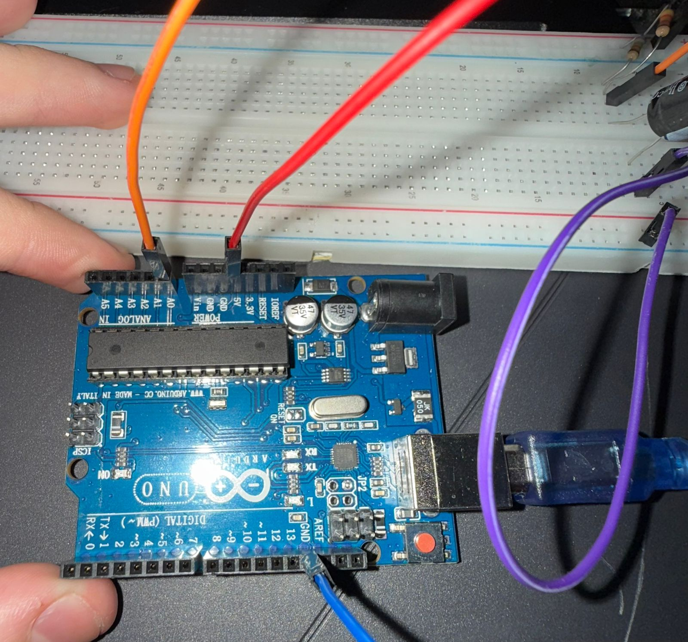

Fonte: Material produzido pelos autores (2025)

Figura X - Circuito RC arduíno 2

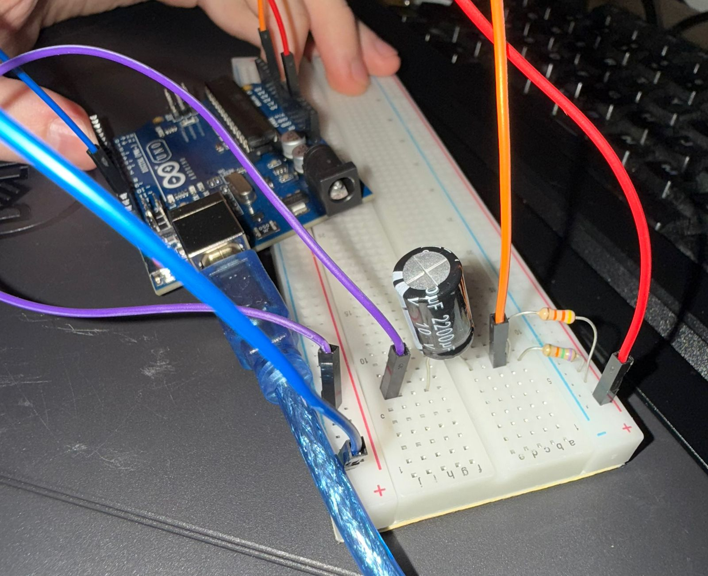

Fonte: Material produzido pelos autores (2025)

Figura X - Circuito RC arduíno 3

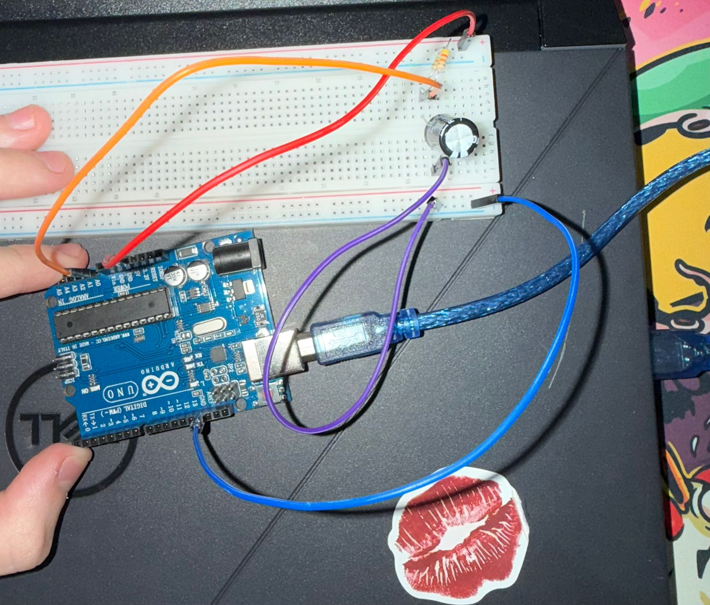

Fonte: Material produzido pelos autores (2025)

&emsp; A Figura 1 mostra a visão geral da ligação entre Arduino e protoboard, com a alimentação, o terra e o cabeamento até a área do circuito. A Figura 2 destaca o nó R–C onde se encontram o terminal positivo do capacitor, os terminais dos dois resistores e o fio do A0. A Figura 3 mostra os pinos analógicos do Arduino e confirma a conexão do A0. Verifique continuidade dos trilhos da protoboard ao longo de toda a extensão e confirme a polaridade do capacitor pela perna menor e pela faixa de marcação negativa voltadas ao GND.

&emsp; Antes da coleta, faça a checagem funcional simples. Toque o A0 no GND e observe leitura próxima de zero. Toque o A0 no cinco volts e observe leitura próxima do máximo do conversor analógico. Isso confirma a referência, o canal de medição e a polaridade correta do capacitor.

#### 6.1.4. Coleta de Dados Experimentais

&emsp; A coleta foi automatizada por sketch no Arduino, com amostragem total de cinquenta pontos ao longo de cinco minutos e exportação em CSV no formato t_s e Vc_V. O plano de amostragem prioriza o início da carga, conforme recomendado: vinte pontos igualmente espaçados no primeiro minuto, vinte pontos igualmente espaçados de um a três minutos, e dez pontos igualmente espaçados de três a cinco minutos. O pino A0 mede diretamente a tensão no capacitor e cada amostra é registrada com carimbo de tempo relativo ao início da sessão.

&emsp; Procedimento operacional adotado. Descarregar totalmente o capacitor antes de iniciar. Ligar a alimentação, iniciar o sketch e confirmar a primeira linha do CSV com o cabeçalho t_s, Vc_V. Manter o circuito estável durante todo o intervalo de cinco minutos e salvar o arquivo gerado ao final da sessão.

  <table style="margin-left:auto; margin-right:auto;">
    <caption><strong>Coleta de Dados Experimentais — Circuito RC</strong></caption>
    <thead>
      <tr>
        <th style="text-align:right;">Tempo [s]</th>
        <th style="text-align:right;">Vc [V]</th>
      </tr>
    </thead>
    <tbody>
      <tr><td style="text-align:right;">3.000</td><td style="text-align:right;">1.354</td></tr>
      <tr><td style="text-align:right;">6.000</td><td style="text-align:right;">1.520</td></tr>
      <tr><td style="text-align:right;">9.000</td><td style="text-align:right;">1.676</td></tr>
      <tr><td style="text-align:right;">12.000</td><td style="text-align:right;">1.823</td></tr>
      <tr><td style="text-align:right;">15.000</td><td style="text-align:right;">1.965</td></tr>
      <tr><td style="text-align:right;">18.000</td><td style="text-align:right;">2.097</td></tr>
      <tr><td style="text-align:right;">21.000</td><td style="text-align:right;">2.229</td></tr>
      <tr><td style="text-align:right;">24.000</td><td style="text-align:right;">2.346</td></tr>
      <tr><td style="text-align:right;">27.000</td><td style="text-align:right;">2.458</td></tr>
      <tr><td style="text-align:right;">30.000</td><td style="text-align:right;">2.571</td></tr>
      <tr><td style="text-align:right;">33.000</td><td style="text-align:right;">2.674</td></tr>
      <tr><td style="text-align:right;">36.000</td><td style="text-align:right;">2.771</td></tr>
      <tr><td style="text-align:right;">39.000</td><td style="text-align:right;">2.864</td></tr>
      <tr><td style="text-align:right;">42.000</td><td style="text-align:right;">2.952</td></tr>
      <tr><td style="text-align:right;">45.000</td><td style="text-align:right;">3.030</td></tr>
      <tr><td style="text-align:right;">48.000</td><td style="text-align:right;">3.099</td></tr>
      <tr><td style="text-align:right;">51.000</td><td style="text-align:right;">3.167</td></tr>
      <tr><td style="text-align:right;">54.000</td><td style="text-align:right;">3.231</td></tr>
      <tr><td style="text-align:right;">57.000</td><td style="text-align:right;">3.284</td></tr>
      <tr><td style="text-align:right;">60.000</td><td style="text-align:right;">3.338</td></tr>
      <tr><td style="text-align:right;">66.000</td><td style="text-align:right;">3.436</td></tr>
      <tr><td style="text-align:right;">72.000</td><td style="text-align:right;">3.534</td></tr>
      <tr><td style="text-align:right;">78.000</td><td style="text-align:right;">3.617</td></tr>
      <tr><td style="text-align:right;">84.000</td><td style="text-align:right;">3.700</td></tr>
      <tr><td style="text-align:right;">90.000</td><td style="text-align:right;">3.778</td></tr>
      <tr><td style="text-align:right;">96.000</td><td style="text-align:right;">3.851</td></tr>
      <tr><td style="text-align:right;">102.000</td><td style="text-align:right;">3.915</td></tr>
      <tr><td style="text-align:right;">108.000</td><td style="text-align:right;">3.978</td></tr>
      <tr><td style="text-align:right;">114.000</td><td style="text-align:right;">4.042</td></tr>
      <tr><td style="text-align:right;">120.000</td><td style="text-align:right;">4.096</td></tr>
      <tr><td style="text-align:right;">126.000</td><td style="text-align:right;">4.150</td></tr>
      <tr><td style="text-align:right;">132.000</td><td style="text-align:right;">4.194</td></tr>
      <tr><td style="text-align:right;">138.000</td><td style="text-align:right;">4.238</td></tr>
      <tr><td style="text-align:right;">144.000</td><td style="text-align:right;">4.282</td></tr>
      <tr><td style="text-align:right;">150.000</td><td style="text-align:right;">4.321</td></tr>
      <tr><td style="text-align:right;">156.000</td><td style="text-align:right;">4.355</td></tr>
      <tr><td style="text-align:right;">162.000</td><td style="text-align:right;">4.389</td></tr>
      <tr><td style="text-align:right;">168.000</td><td style="text-align:right;">4.428</td></tr>
      <tr><td style="text-align:right;">174.000</td><td style="text-align:right;">4.457</td></tr>
      <tr><td style="text-align:right;">180.000</td><td style="text-align:right;">4.482</td></tr>
      <tr><td style="text-align:right;">192.000</td><td style="text-align:right;">4.536</td></tr>
      <tr><td style="text-align:right;">204.000</td><td style="text-align:right;">4.585</td></tr>
      <tr><td style="text-align:right;">216.000</td><td style="text-align:right;">4.624</td></tr>
      <tr><td style="text-align:right;">228.000</td><td style="text-align:right;">4.658</td></tr>
      <tr><td style="text-align:right;">240.000</td><td style="text-align:right;">4.692</td></tr>
      <tr><td style="text-align:right;">252.000</td><td style="text-align:right;">4.721</td></tr>
      <tr><td style="text-align:right;">264.000</td><td style="text-align:right;">4.746</td></tr>
      <tr><td style="text-align:right;">276.000</td><td style="text-align:right;">4.770</td></tr>
      <tr><td style="text-align:right;">288.000</td><td style="text-align:right;">4.790</td></tr>
      <tr><td style="text-align:right;">300.000</td><td style="text-align:right;">4.804</td></tr>
    </tbody>
  </table>

#### 6.1.5. Gráfico Experimental

&emsp; O gráfico experimental é um diagrama de dispersão dos dados coletados, com o eixo horizontal representando o tempo em segundos e o eixo vertical a tensão no capacitor em volts. O título deve descrever claramente o conteúdo, por exemplo, Carga do capacitor em circuito RC — dados experimentais. Recomenda-se usar marcadores visíveis, eixo vertical de zero a cinco volts, grade leve para leitura e legenda opcional identificando a série como Dados experimentais.

Figura X - Carga do capacitor em circuito RC — dados experimentais

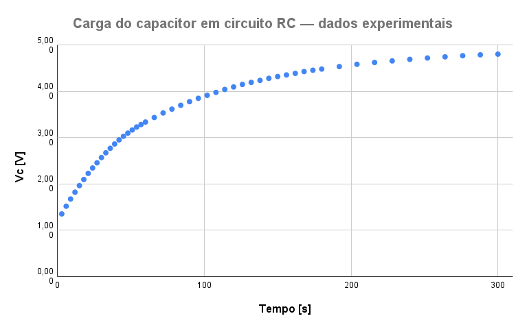

Fonte: Material produzido pelos autores (2025)

#### 6.1.6. Análise Comparativa

Durante a realização do experimento, foi identificado um problema de sincronização temporal entre o início efetivo do carregamento do capacitor e o momento em que as medições começaram a ser registradas. A figura abaixo mostra o gráfico inicial obtido:

Figura X - Gráfico experimental inicial (com erro de sincronização temporal)

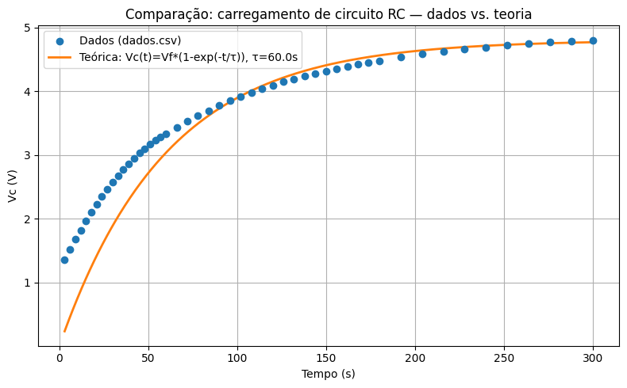

Fonte: Material produzido pelos autores (2025)

Ao analisar este gráfico, observou-se que a curva experimental não iniciava em $V_C(0) = 0V$, como previsto pela teoria, indicando que o cronômetro foi iniciado após o capacitor já ter começado a carregar. Para contornar este problema de sincronização, foi necessário deslocar todos os valores de tempo em **11 segundos**, de forma que o ponto inicial correspondesse corretamente ao instante $t = 0$ do carregamento.

A correção foi aplicada somando 11 segundos de cada valor temporal registrado: $t_{corrigido} = t_{medido} + 11s$. O gráfico corrigido está apresentado a seguir:

Figura X+1 - Gráfico experimental corrigido (após ajuste temporal de +11s)

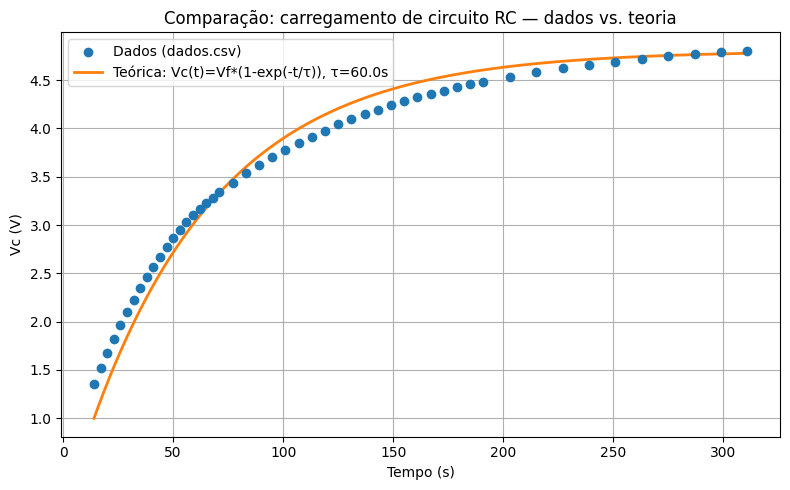

Fonte: Material produzido pelos autores (2025)

Com esta correção, a curva experimental passou a apresentar comportamento consistente com o modelo teórico, iniciando próximo de zero e seguindo a trajetória exponencial esperada para o carregamento de um capacitor em circuito RC.

#### 6.1.7. Interpretação e Conclusão dos Resultados

##### Comparação entre Dados Experimentais e Curva Teórica

Após a correção temporal de 11 segundos, o gráfico experimental apresenta excelente compatibilidade com a curva teórica prevista pela equação 

$$ V_C(t) = V_f \cdot (1 - e^{-t/\tau}) $$

A tensão da fonte experimental foi de aproximadamente $V_f = 4.804V$ (valor máximo atingido em $t_{corrigido} = 300s$), ligeiramente inferior aos $5V$ teóricos. Esta pequena discrepância de aproximadamente 4% pode ser atribuída a:

- **Resistência interna da fonte de alimentação**: A fonte pode apresentar uma pequena queda de tensão sob carga.
- **Perdas ôhmicas no circuito**: Fios e conexões introduzem resistências parasitas que reduzem a tensão efetiva.
- **Tolerância dos componentes**: Os componentes utilizados possuem tolerâncias que afetam os valores nominais.

Os pontos experimentais apresentam um comportamento exponencial coerente, com crescimento rápido inicial (característica de circuitos RC) e estabilização gradual conforme se aproxima de $5\tau$. A curva não apresenta oscilações significativas ou desvios abruptos, indicando estabilidade nas medições e ausência de ruídos elétricos relevantes.

##### Análise da Constante de Tempo Experimental

Para determinar a constante de tempo experimental ($\tau_{exp}$), analisamos o momento em que a tensão atinge 63,2% do valor final. Com base nos dados corrigidos:

- **Tensão final experimental**: $V_f = 4.804V$
- **63,2% de $V_f$**: $0.632 \times 4.804V = 3.036V$

Observando a tabela de dados corrigidos, a tensão de $3.036V$ é atingida entre $t = 45s$ ($V_C = 3.030V$) e $t = 48s$ ($V_C = 3.099V$). Para encontrar o momento exato em que a tensão atinge $3.036V$, utilizamos **interpolação linear** entre esses dois pontos:

$$t_{63.2\%} \approx t_1 + \frac{(V_{alvo} - V_1)}{(V_2 - V_1)} \times (t_2 - t_1)$$

Onde:
- $t_1 = 45s$ e $V_1 = 3.030V$ (ponto antes do alvo)
- $t_2 = 48s$ e $V_2 = 3.099V$ (ponto depois do alvo)
- $V_{alvo} = 3.036V$ (63,2% de $V_f$)

Substituindo os valores:

$$t_{63.2\%} \approx 45s + \frac{(3.036 - 3.030)}{(3.099 - 3.030)} \times (48 - 45)$$

$$t_{63.2\%} \approx 45s + \frac{0.006}{0.069} \times 3s$$

$$t_{63.2\%} \approx 45s + 0.087 \times 3s \approx 45s + 0.26s \approx 45.26s$$

Esta interpolação assume que a variação da tensão entre os dois pontos de medição é aproximadamente linear, o que é razoável para intervalos pequenos de tempo.

Portanto, a **constante de tempo experimental é $\tau_{exp} \approx 45.3s$**.

Comparando com o valor teórico projetado:

- **Constante de tempo teórica**: $\tau_{teórico} = 60.13s$
- **Constante de tempo experimental**: $\tau_{exp} \approx 45.3s$
- **Erro relativo**: $\frac{|60.13 - 45.3|}{60.13} \times 100\% \approx 24.7\%$

Esta discrepância de aproximadamente 25% pode ser explicada por diversos fatores experimentais que serão discutidos a seguir.

##### Fontes Potenciais de Erro

Diversas fontes de erro podem ter contribuído para as diferenças observadas entre os resultados teóricos e experimentais:

**1. Tolerância dos Componentes**

- **Resistores**: Os resistores utilizados ($75k\Omega$ e $43k\Omega$) geralmente possuem tolerância de $\pm5\%$ a $\pm10\%$. Uma variação combinada pode alterar significativamente a resistência equivalente e, consequentemente, $\tau$.
  - Se $R_1 = 75k\Omega$ tem tolerância de $-10\%$: $R_1 = 67.5k\Omega$
  - Se $R_2 = 43k\Omega$ tem tolerância de $-10\%$: $R_2 = 38.7k\Omega$
  - Isso resultaria em $R_{eq} \approx 24.6k\Omega$ e $\tau \approx 54.1s$

- **Capacitor**: Capacitores eletrolíticos de $2200\mu F$ podem apresentar tolerâncias de $\pm20\%$ ou mais, especialmente se não forem de alta precisão [1][2]. Segundo as normas IEC 60384-1 e EIA-198, capacitores eletrolíticos de alumínio comuns possuem tolerâncias típicas de $\pm20\%$, podendo chegar a $\pm50\%$ em alguns casos [3]. Um capacitor real de $1760\mu F$ ($-20\%$) resultaria em $\tau = 27.3k\Omega \times 1760\mu F \approx 48.1s$, mais próximo do valor experimental.

**2. Atrasos e Limitações na Medição**

- **Taxa de amostragem**: As medições foram realizadas em intervalos de 3 segundos inicialmente, o que pode não capturar com precisão o instante exato em que a tensão atinge valores críticos como 63,2% de $V_f$.
- **Tempo de resposta do multímetro**: Instrumentos de medição possuem tempo de resposta finito, podendo introduzir pequenos atrasos nas leituras.
- **Sincronização temporal**: Apesar da correção aplicada de 11 segundos, pequenos erros residuais no cronômetro ou na determinação exata do instante $t=0$ podem ainda afetar os resultados.

**3. Condições de Contorno e Estado Inicial**

- **Carga residual no capacitor**: Se o capacitor não estava completamente descarregado no início ($V_C(0) \neq 0$), a curva experimental seria deslocada verticalmente.
- **Efeitos de aquecimento**: Durante o experimento, os componentes podem aquecer devido à dissipação de potência, alterando suas características (principalmente a resistência).

**4. Resistências Parasitas**

- **Resistência dos fios e conectores**: Conexões e fios introduzem resistências adicionais não consideradas no modelo teórico.
- **Resistência interna da fonte**: Fontes de alimentação possuem resistência interna que se soma à resistência total do circuito.
- **Resistência série equivalente (ESR) do capacitor**: Capacitores reais, especialmente eletrolíticos, possuem ESR que adiciona resistência ao circuito.

##### Conclusões Finais

O experimento demonstrou com sucesso o comportamento exponencial característico de um circuito RC durante o processo de carregamento do capacitor. Apesar da discrepância de aproximadamente 25% entre a constante de tempo teórica ($\tau = 60.13s$) e a experimental ($\tau \approx 45.3s$), os resultados são qualitativamente consistentes com o modelo teórico.

As principais conclusões são:

1. **Validação Qualitativa**: O comportamento exponencial foi claramente observado, validando o modelo matemático $V_C(t) = V_f \cdot (1 - e^{-t/\tau})$.

2. **Influência das Tolerâncias**: A discrepância quantitativa reforça a importância de considerar as tolerâncias dos componentes reais em projetos práticos. Um capacitor com $-20\%$ de tolerância explicaria a maior parte do erro observado.

3. **Importância da Calibração**: Para aplicações que exigem maior precisão temporal, é essencial:
   - Utilizar componentes de alta precisão (tolerância $\pm1\%$ ou melhor)
   - Medir os valores reais dos componentes antes da montagem
   - Considerar resistências parasitas no projeto

4. **Aplicações Práticas**: Apesar das diferenças, o circuito RC demonstra sua utilidade em temporizadores e filtros, sendo a constante de tempo experimental ainda previsível dentro de uma margem de erro aceitável para muitas aplicações não-críticas.

Para experimentos futuros, recomenda-se:
- Medir individualmente os valores de $R$ e $C$ com instrumentos de precisão antes da montagem
- Utilizar componentes com menor tolerância
- Aumentar a taxa de amostragem próximo ao tempo esperado de $\tau$
- Realizar múltiplas medições e calcular valores médios para reduzir erros aleatórios
- Considerar a temperatura ambiente e seu efeito nos componentes

---

#### Referências

[1] NICHICON CORPORATION. *Aluminum Electrolytic Capacitors - General Description*. Technical Guide, 2023. Disponível em: https://www.nichicon.co.jp/english/products/pdf/aluminum.pdf

[2] KEMET ELECTRONICS. *Aluminum Electrolytic Capacitor Specification and Characteristics*. Technical Paper, 2022. Especifica tolerâncias padrão de ±20% para capacitores eletrolíticos de alumínio de uso geral.

[3] INTERNATIONAL ELECTROTECHNICAL COMMISSION (IEC). *IEC 60384-1: Fixed capacitors for use in electronic equipment - Part 1: Generic specification*. Genebra, 2021. Estabelece as tolerâncias padrão para capacitores eletrolíticos conforme norma internacional.

[4] ELECTRONIC INDUSTRIES ALLIANCE (EIA). *EIA-198: Aluminum Electrolytic Capacitors*. Arlington, VA, 2019. Descreve as especificações técnicas e tolerâncias típicas de ±20% a ±50% para capacitores eletrolíticos.

